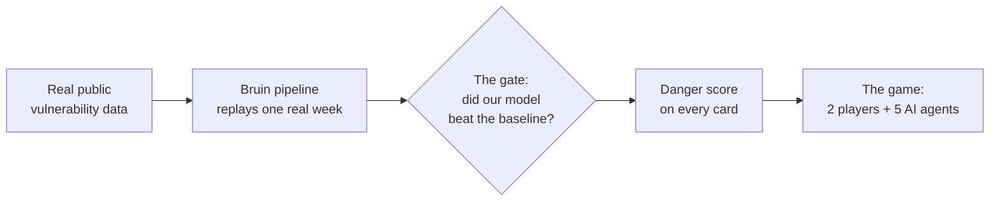

# Patch Tuesday

Patch Tuesday is a 3D co-op game about one question every IT team faces each week: *thousands of
new software bugs were published, which few do we fix first?*

You and a friend defend a network of 20 machines. Each machine carries **cards**. Every card is a
real, publicly listed software vulnerability (a "CVE"). Two hidden AI attackers try to break in
through those cards. Three AI defenders help you. Each card shows a **danger**: the predicted
chance (0-100%) that this bug will really be exploited. The danger numbers are not made up. A data
pipeline built with [Bruin](https://getbruin.com) computes them from real public data, one real
week at a time.

Attacks are abstract game moves. No exploit code, payloads, reference URLs or CVE description text
reach the game. A card shows only the vendor, the product, the kind of weakness, a severity rating,
its danger and whether the bug is already known to be exploited.


## How you win

A match lasts 5 minutes: 150 ticks of 2 seconds, a tick being one step of the game clock. The team
with the higher score wins.

| What happens | Points |
|---|---|
| Red holds a breached machine | Red gets the machine's value (1-3) every tick |
| Red breaches a machine for the first time | Red +5 |
| Blue patches a card before Red tries it | Blue + machine value x danger |
| Blue restores a breached machine | Blue +3, and Red's income from it stops |
| Blue isolates a machine | Blue -1 every tick it stays isolated |

So: patch the most dangerous cards on the most valuable machines first, and restore anything that
turns red. The full rules and a guided first match are in [docs/PLAY.md](docs/PLAY.md).

## The picture



## The one idea

1. **Replay real weeks.** The project holds a copy of real vulnerability data up to 2026-11-23. The
   game starts with **data as of** 2026-03-22 and can see nothing later. Pressing **Advance week**
   re-runs the pipeline for the next real week, up to 2026-06-14.
2. **Our model must beat the baseline to set the danger.** Each week the pipeline retrains **our
   model** and compares it with the **EPSS baseline**, the public industry-standard score. The test
   is **hits in top 50**: of each scorer's 50 top picks, how many really became **known exploited
   (KEV)**, meaning listed in the US agency CISA's Known Exploited Vulnerabilities catalogue, within
   91 days. **The gate** is a blocking check in the pipeline. Only if our model has strictly more
   hits does it replace EPSS. Otherwise the game keeps the EPSS baseline.
3. **Then see what really happened.** Because the weeks are real and already in the past, the end
   of a match shows which cards on your board really became known exploited afterwards.

## The headline result

Over the 12 replayed weeks, our model passed the gate 11 times and was blocked once. On day 0 it
was also blocked, by a 0-0 tie. In total our model put 36 soon-to-be-exploited bugs in its weekly
top 50, against 8 for the EPSS baseline.

Read this with care: the margin is 1 to 5 bugs a week out of about 172,000 to 185,000 candidates,
which is small and noisy, and the test favours our model. The full table, the proof that the gate
really blocks, and every caveat are in [docs/MODEL_AND_GATE.md](docs/MODEL_AND_GATE.md).

## Quick start

You need Windows with WSL Ubuntu, Bruin, Python 3.12 and Node.js. The one-time setup of WSL, Bruin
and the two config files is in [docs/RUNNING.md](docs/RUNNING.md). After that, five commands:

```bash
# 1 and 2: in WSL, from the repo root
bash scripts/pull_data.sh               # download the public data once
python3 scripts/advance.py --day0       # build the day-0 world (about 2 minutes)
```

```powershell
# 3 to 5: in PowerShell, from the repo root
py -3.12 -m venv .venv; .venv\Scripts\pip install -r game\requirements.txt
cd web; npm install; cd ..
scripts\start.ps1                       # then open http://localhost:5173
```

No WSL or Bruin at hand? `http://localhost:5173/?mock=1` runs the screen on built-in fake data with
no server.

## Who is on the board

| Who | Team | What they do |
|---|---|---|
| Player 1, Player 2 | Blue, human | Move, patch, monitor, isolate and restore from the keyboard |
| Triage (`blue1`) | Blue, AI | Follows the pipeline's patch-priority list wherever it leads |
| Patcher (`blue2`) | Blue, AI | Walks to the highest-value exposed machine and patches it clean |
| Hunter (`blue3`) | Blue, AI | Monitors (revealing hidden attackers), restores, isolates under pressure; with Telem switched on, runs INTEL searches |
| Opportunist (`red1`) | Red, AI | Chases fresh, high-danger cards it believes are unpatched; exploits without scanning |
| Patient (`red2`) | Red, AI | Scans first, waits for a good breach chance, prefers older cards and pivots from machines it holds |

Triage and Patcher also break off to restore a breached machine when they are the nearest free
defender. Every decision each of the seven makes is written to a log with a one-sentence reason,
visible on screen.

## Where to read next

| Document | For whom | What is in it |
|---|---|---|
| [docs/PLAY.md](docs/PLAY.md) | Players | Goal, scoring, each action and when to use it, a guided first match |
| [docs/UI_GUIDE.md](docs/UI_GUIDE.md) | Players | Every panel, colour and icon on the screen |
| [docs/HOW_IT_WORKS.md](docs/HOW_IT_WORKS.md) | Anyone curious | The three loops (tick, match, week) and one real CVE followed end to end |
| [docs/DEMO.md](docs/DEMO.md) | Presenters, judges | A timed 2-minute demo and a sheet mapping the hackathon criteria to the screen and the repo |
| [docs/RUNNING.md](docs/RUNNING.md) | Whoever runs it | Setup, daily commands, sharing with teammates, troubleshooting |
| [docs/PIPELINE.md](docs/PIPELINE.md) | Data engineers | How the project uses Bruin: layers, all 27 assets, the feature map |
| [docs/MODEL_AND_GATE.md](docs/MODEL_AND_GATE.md) | ML and security readers | The model, the gate, 12 weeks of results, the leakage audit, known limits |
| [docs/DATA_SOURCES.md](docs/DATA_SOURCES.md) | Anyone reusing the data | Sources, notices and licences |
| [docs/GLOSSARY.md](docs/GLOSSARY.md) | Everyone | Every term in one line |
| [docs/CONTRACTS.md](docs/CONTRACTS.md) | Developers | The fixed interfaces between pipeline, game server and web client |
| [docs/BRUIN_NOTES.md](docs/BRUIN_NOTES.md) | Bruin users | What Bruin v0.11.831 really does, tested |

The full index with a reading path per audience is [docs/README.md](docs/README.md).

## Data notices

This product uses data from the NVD API but is not endorsed or certified by the NVD. Use of the
CISA KEV data does not imply endorsement by CISA or DHS. EPSS scores come from FIRST.org
(https://www.first.org/epss). © 2026 The MITRE Corporation: ATT&CK and CAPEC are reproduced and
distributed with the permission of The MITRE Corporation. Details: [docs/DATA_SOURCES.md](docs/DATA_SOURCES.md).
