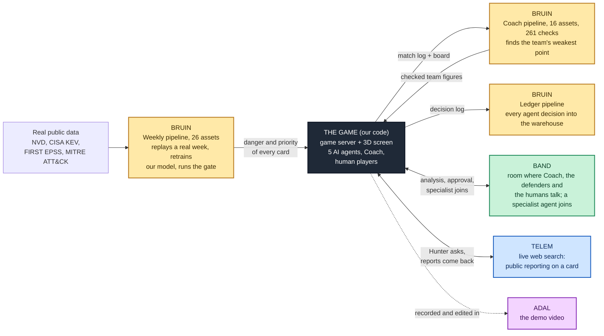
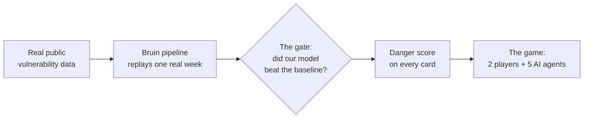
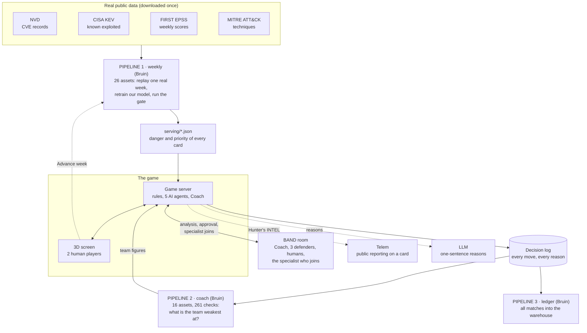
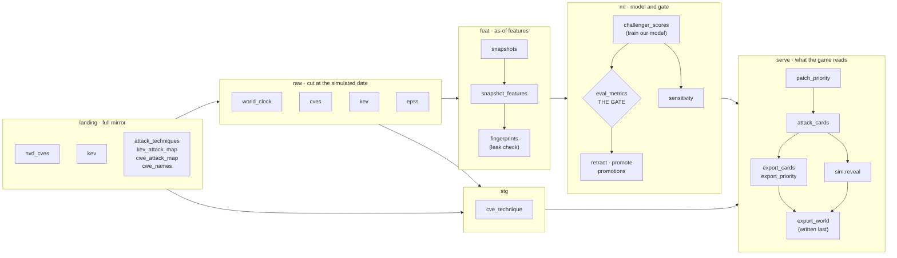
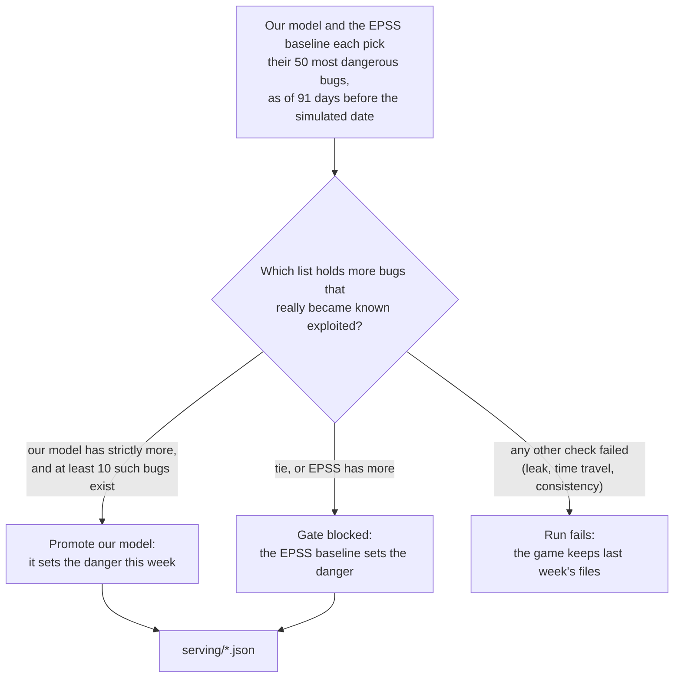
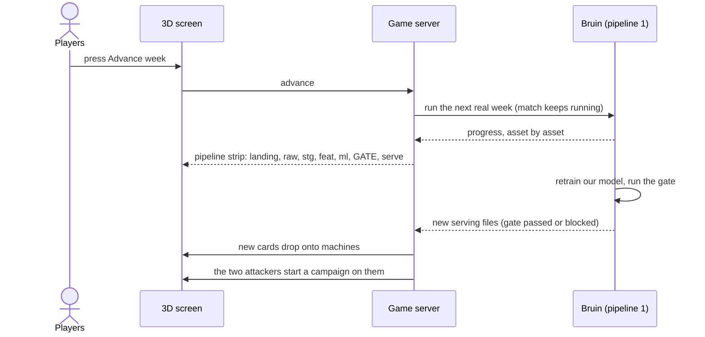
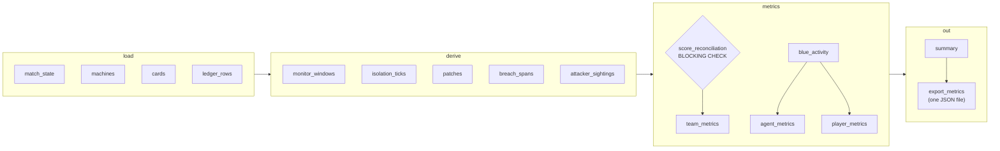
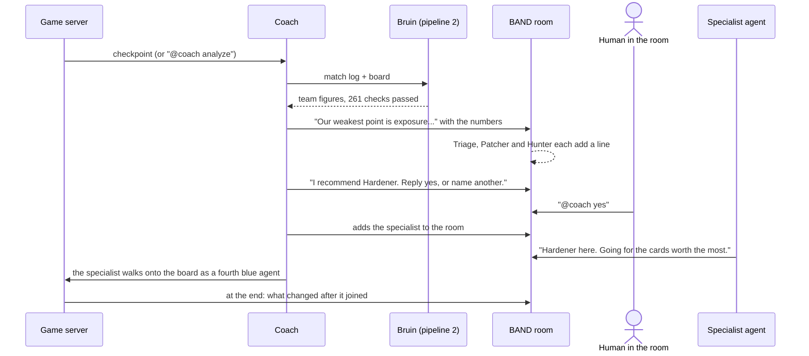
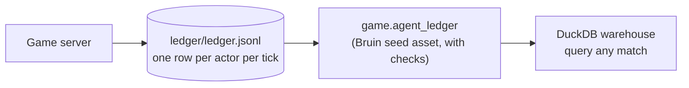

# Patch Tuesday

Patch Tuesday is a 3D co-op game about one question every IT team faces each week: *thousands of
new software bugs were published, which few do we fix first?*

You and a friend defend a network of 20 machines. Each machine carries **cards**. Every card is a
real, publicly listed software vulnerability (a "CVE"). Two hidden AI attackers try to break in
through those cards. Three AI defenders help you. Each card shows a **danger**: the predicted
chance (0-100%) that this bug will really be exploited. The danger numbers are not made up. A data
pipeline built with [Bruin](https://getbruin.com) computes them from real public data, one real
week at a time.

Attacks are abstract game moves. No exploit code, payloads, reference URLs or CVE description text
reach the game. A card shows only the vendor, the product, the kind of weakness, a severity rating,
its danger and whether the bug is already known to be exploited.

![Patch Tuesday mid-match. Top bar: both scores with what is driving them, the time left, and the data panel with the date the data is as of and the gate verdict. Centre: the 3D network of 20 machines on four terraces, with the robots of both players and the AI agents; the back rows stand higher, so moving between rows is a jump. Right: the Coach box (team weakness: exposure, Hardener called in as backup) and one card per AI agent with what it is doing and why. Bottom: the two player panels, each with a "next best move" line, the cards on its machine and a name box to take the seat, then the events strip.](docs/img/game.png)

*A real match on the day-0 data (2026-03-22). Coach found the team's weakest point, nobody answered in BAND, so it called in the Hardener specialist, the white robot at the front right, as a fourth Blue agent.*

## Sponsor tools: where each one sits

Four hackathon sponsor tools are part of this project. The coloured boxes show where each one
works; everything else is our own code.



| Colour | Sponsor | Role in one line |
|---|---|---|
| Yellow | **Bruin** | Decides how dangerous every card is, coaches the team, and keeps the decision log |
| Green | **BAND** | The room where agents and humans talk, and through which a new agent joins the team |
| Blue | **Telem** | Gives an agent live public reporting on a vulnerability |
| Purple | **AdaL** | Produces the demo video |

### Bruin

Bruin is the data pipeline tool, and here it is the referee of the game. We run three Bruin
pipelines on DuckDB.

- **Weekly pipeline (26 assets).** It replays real vulnerability data one real week at a time,
  hiding everything after the simulated date. Each week it retrains our model and runs **the
  gate**: a blocking check that lets our model set the danger only if it beats the EPSS baseline
  on held-out data. If the gate fails, Bruin skips everything after it and the game keeps the
  baseline. This happened for real: the gate blocked the model once in 12 weeks, plus a tie on day 0.
- **Coach pipeline (16 assets, 261 checks, about 3 seconds).** During a match it takes the
  decision log and the board and computes what the Blue team is weakest at. Its own blocking
  check recomputes Red's income from the log and refuses to answer unless it matches the game's
  score.
- **Ledger pipeline.** Every decision by every agent is loaded into the warehouse for analysis.

The pipelines run live from the game: pressing **Advance week** starts a real Bruin run, and the
screen shows it step by step. Bruin features in use include SQL and Python assets, seeds,
incremental `time_interval` loads, `delete+insert` and `ddl` strategies, blocking custom checks,
pipeline variables, tags, a glossary, lineage and a 12-week backfill.
Details: [docs/PIPELINE.md](docs/PIPELINE.md), [docs/MODEL_AND_GATE.md](docs/MODEL_AND_GATE.md).

### BAND

BAND is where the agents and the humans talk, and how a new agent joins the team. We call the use
case **Call for backup**.

- Coach, Triage, Patcher, Hunter and three specialists are **separate BAND agents**. Coach and
  the three defenders share one room with the human players.
- At a checkpoint Coach posts the team's weakest point with the numbers from the Bruin coach
  pipeline. The three defenders each add a line from their own side.
- Coach recommends one specialist and **asks the humans to approve it in the room**. A human
  replies there.
- The specialist is then **added to the room**, introduces itself, and walks onto the board as a
  fourth Blue agent. At the end Coach posts what changed after it joined.
- If a player goes quiet for 30 seconds, Coach says so in the room and hands that player's robot
  to the Hardener routine until they return.
- A second room carries a running feed of match highlights.

Under the hood this uses BAND's agent registration, rooms, messages with @mentions, adding a
participant, and each agent's inbox with acknowledgements. Details: [docs/BAND.md](docs/BAND.md).

### Telem

Telem gives agents live web data. The Hunter agent uses it for an **INTEL** move.

- In a quiet moment the Hunter asks Telem for public reporting on one card's CVE, limited to the
  simulated week.
- The result appears in the events strip and in the Hunter's reasoning, for example "Hunter found
  2 public reports on CVE-2026-32596 this world week", with the reporting sites and dates.
- Headlines and anything that looks like exploit material are dropped; only counts, sites and
  dates are shown.
- Searches are capped per match and per server run, so a demo cannot run up a bill.

Switch it on with `scripts\start.ps1 -Telem`. Code: `game/intel.py`.

### AdaL

AdaL is the agentic video editor. We use it to produce the project's demo video from a recording
of a live match, following the timed script in [docs/DEMO.md](docs/DEMO.md).

## How you win

A match lasts 5 minutes: 150 ticks of 2 seconds, a tick being one step of the game clock. The team
with the higher score wins.

| What happens | Points |
|---|---|
| Red holds a breached machine | Red gets the machine's value (1-3) every tick |
| Red breaches a machine for the first time | Red +5 |
| Blue patches a card before Red tries it | Blue + machine value x danger |
| Blue restores a breached machine | Blue +3, and Red's income from it stops |
| Blue isolates a machine | Blue -1 every tick it stays isolated |

So: patch the most dangerous cards on the most valuable machines first, and restore anything that
turns red. The full rules and a guided first match are in [docs/PLAY.md](docs/PLAY.md).

## The picture



## How the system works, in pictures

Three Bruin pipelines sit around one game. The first decides how dangerous every card is, the
second coaches the team from its own match log, the third keeps every agent decision for analysis.

### 1. The whole system



### 2. Pipeline 1: the weekly pipeline (26 assets)

Each run moves the simulated date forward one real week. Nothing dated after that date can reach
the features or the model. The gate is a blocking check: if it fails, everything after it is
skipped and the game keeps the EPSS baseline.



### 3. The gate, and what the game gets



### 4. One press of "Advance week"



### 5. Pipeline 2: the coach pipeline (16 assets, 261 checks, about 3 seconds)

It reads two files the game hands over at the checkpoint: the match log so far and the board.
The reconciliation asset is its gate: Red's income recomputed from the log must equal the game's
own score, or no analysis is produced.



### 6. Call for backup: Coach, Bruin and BAND together



If nobody replies in time, Coach brings in its own recommendation. If a player goes quiet for 30
seconds, Coach hands that player's robot to the Hardener routine until they press a key again.

### 7. Pipeline 3: the ledger pipeline



More detail: [docs/PIPELINE.md](docs/PIPELINE.md) (every asset and Bruin feature),
[docs/MODEL_AND_GATE.md](docs/MODEL_AND_GATE.md) (the model and 12 weeks of gate results),
[docs/BAND.md](docs/BAND.md) (Call for backup).

## The one idea

1. **Replay real weeks.** The project holds a copy of real vulnerability data up to 2026-11-23. The
   game starts with **data as of** 2026-03-22 and can see nothing later. Pressing **Advance week**
   re-runs the pipeline for the next real week, up to 2026-06-14.
2. **Our model must beat the baseline to set the danger.** Each week the pipeline retrains **our
   model** and compares it with the **EPSS baseline**, the public industry-standard score. The test
   is **hits in top 50**: of each scorer's 50 top picks, how many really became **known exploited
   (KEV)**, meaning listed in the US agency CISA's Known Exploited Vulnerabilities catalogue, within
   91 days. **The gate** is a blocking check in the pipeline. Only if our model has strictly more
   hits does it replace EPSS. Otherwise the game keeps the EPSS baseline.
3. **Then see what really happened.** Because the weeks are real and already in the past, the end
   of a match shows which cards on your board really became known exploited afterwards.

## The headline result

Over the 12 replayed weeks, our model passed the gate 11 times and was blocked once. On day 0 it
was also blocked, by a 0-0 tie. In total our model put 36 soon-to-be-exploited bugs in its weekly
top 50, against 8 for the EPSS baseline.

Read this with care: the margin is 1 to 5 bugs a week out of about 172,000 to 185,000 candidates,
which is small and noisy, and the test favours our model. The full table, the proof that the gate
really blocks, and every caveat are in [docs/MODEL_AND_GATE.md](docs/MODEL_AND_GATE.md).

## Quick start

You need Windows with WSL Ubuntu, Bruin, Python 3.12 and Node.js. The one-time setup of WSL, Bruin
and the two config files is in [docs/RUNNING.md](docs/RUNNING.md). After that, five commands:

```bash
# 1 and 2: in WSL, from the repo root
bash scripts/pull_data.sh               # download the public data once
python3 scripts/advance.py --day0       # build the day-0 world (about 2 minutes)
```

```powershell
# 3 to 5: in PowerShell, from the repo root
py -3.12 -m venv .venv; .venv\Scripts\pip install -r game\requirements.txt
cd web; npm install; cd ..
scripts\start.ps1                       # then open http://localhost:5173
```

No WSL or Bruin at hand? `http://localhost:5173/?mock=1` runs the screen on built-in fake data with
no server.

## Who is on the board

| Who | Team | What they do |
|---|---|---|
| Player 1, Player 2 | Blue, human | Each plays from their own browser: enter a name and take a seat, then move with the arrows or W A S D (or click a machine), Space to jump, and patch, monitor, isolate or restore |
| Triage (`blue1`) | Blue, AI | Follows the pipeline's patch-priority list wherever it leads |
| Patcher (`blue2`) | Blue, AI | Walks to the highest-value exposed machine and patches it clean |
| Hunter (`blue3`) | Blue, AI | Monitors (revealing hidden attackers), restores, isolates under pressure; with Telem switched on, runs INTEL searches |
| Opportunist (`red1`) | Red, AI | Chases fresh, high-danger cards it believes are unpatched; exploits without scanning |
| Patient (`red2`) | Red, AI | Scans first, waits for a good breach chance, prefers older cards and pivots from machines it holds |

Triage and Patcher also break off to restore a breached machine when they are the nearest free
defender. Every decision each of them makes is written to a log with a one-sentence reason,
visible on screen. If a player goes quiet for 30 seconds, Coach hands that player's robot to the
Hardener routine until they press a key again.

**Call for backup (optional, with [BAND](https://band.ai)).** A Coach agent watches the match and
works out what the Blue team is weakest at. It says so in a BAND chat room, where the three blue
agents answer as separate agents, and asks a human to approve one specialist: Responder, Hardener
or Sentinel. On "yes" the specialist joins the room and walks onto the board as a fourth blue AI
agent. Setup and the whole flow: [docs/BAND.md](docs/BAND.md).

## Where to read next

| Document | For whom | What is in it |
|---|---|---|
| [docs/PLAY.md](docs/PLAY.md) | Players | Goal, scoring, each action and when to use it, a guided first match |
| [docs/UI_GUIDE.md](docs/UI_GUIDE.md) | Players | Every panel, colour and icon on the screen |
| [docs/HOW_IT_WORKS.md](docs/HOW_IT_WORKS.md) | Anyone curious | The three loops (tick, match, week) and one real CVE followed end to end |
| [docs/DEMO.md](docs/DEMO.md) | Presenters, judges | A timed 2-minute demo and a sheet mapping the hackathon criteria to the screen and the repo |
| [docs/BAND.md](docs/BAND.md) | Anyone interested in BAND | Call for backup: agents talking in a room, a human approving, a specialist joining the team |
| [docs/RUNNING.md](docs/RUNNING.md) | Whoever runs it | Setup, daily commands, sharing with teammates, troubleshooting |
| [docs/PIPELINE.md](docs/PIPELINE.md) | Data engineers | How the project uses Bruin: layers, all 27 assets, the feature map |
| [docs/MODEL_AND_GATE.md](docs/MODEL_AND_GATE.md) | ML and security readers | The model, the gate, 12 weeks of results, the leakage audit, known limits |
| [docs/DATA_SOURCES.md](docs/DATA_SOURCES.md) | Anyone reusing the data | Sources, notices and licences |
| [docs/GLOSSARY.md](docs/GLOSSARY.md) | Everyone | Every term in one line |
| [docs/CONTRACTS.md](docs/CONTRACTS.md) | Developers | The fixed interfaces between pipeline, game server and web client |
| [docs/BRUIN_NOTES.md](docs/BRUIN_NOTES.md) | Bruin users | What Bruin v0.11.831 really does, tested |

The full index with a reading path per audience is [docs/README.md](docs/README.md).

## Data notices

This product uses data from the NVD API but is not endorsed or certified by the NVD. Use of the
CISA KEV data does not imply endorsement by CISA or DHS. EPSS scores come from FIRST.org
(https://www.first.org/epss). © 2026 The MITRE Corporation: ATT&CK and CAPEC are reproduced and
distributed with the permission of The MITRE Corporation. Details: [docs/DATA_SOURCES.md](docs/DATA_SOURCES.md).
