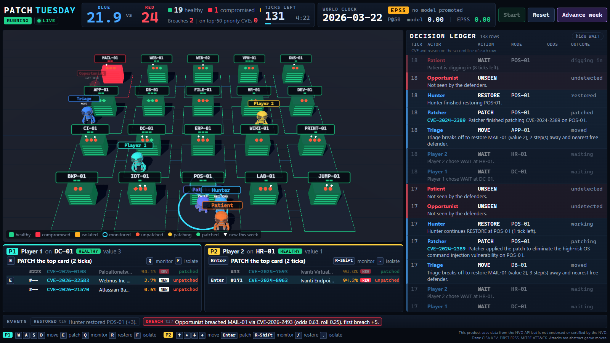
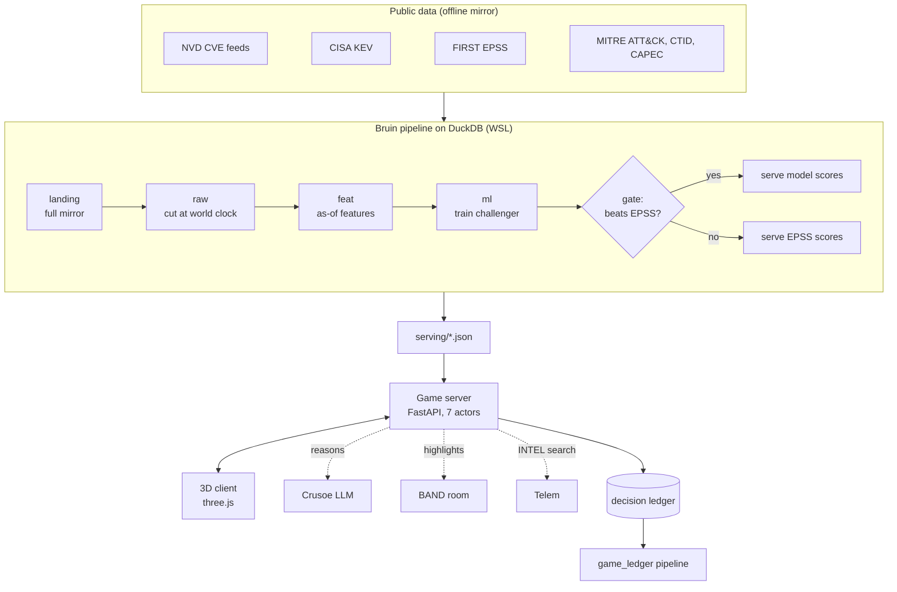
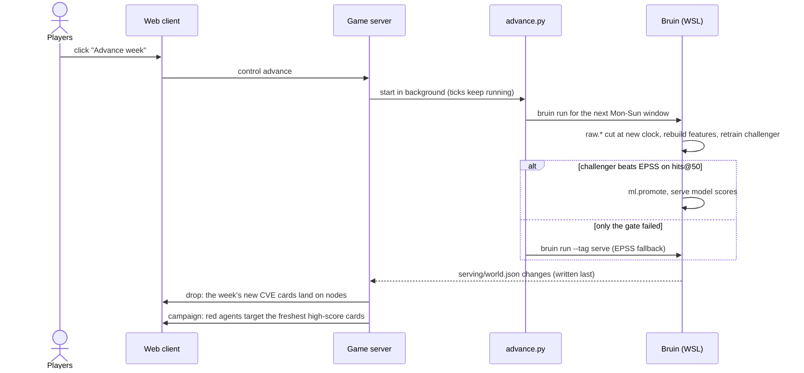
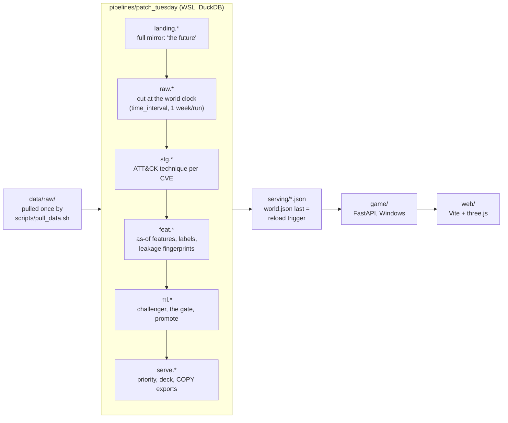
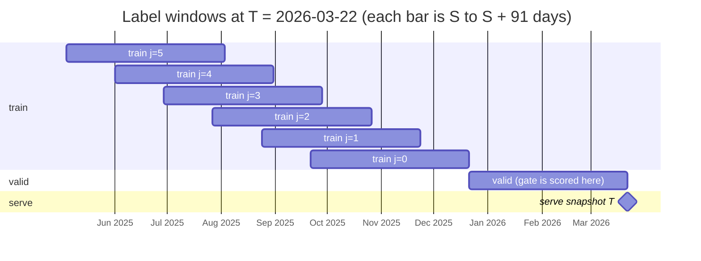
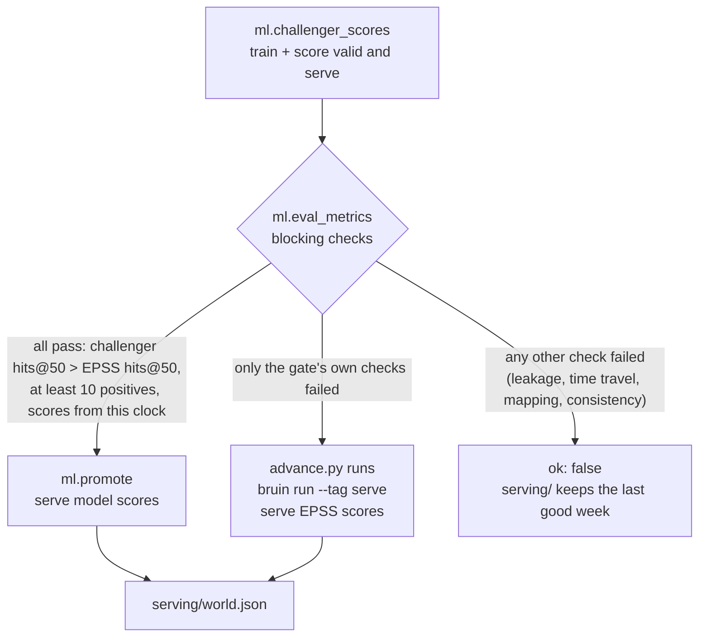
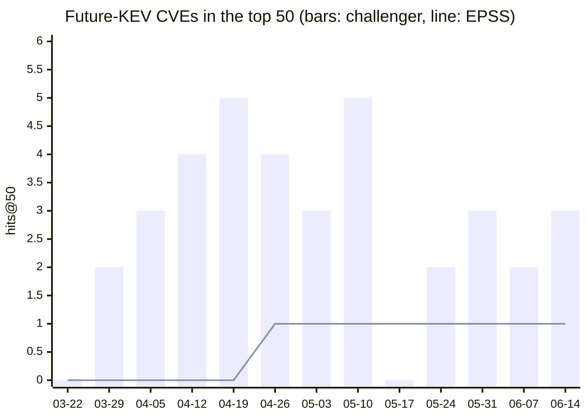

# Patch Tuesday

A 3D co-op game in which simulated attacks are driven by real public vulnerability data. Red agents
"exploit" abstract attack cards (one per real CVE) and blue players patch them. Each card's breach
odds come from a score that a Bruin + DuckDB pipeline rebuilds every simulated week. That week, the
pipeline retrains an exploit-prediction model (the *challenger*) and lets it replace FIRST EPSS only
if it beats EPSS on a held-out snapshot. That rule is the *promotion gate*.

Attacks are abstract game moves. No exploit code, payloads, reference URLs or CVE description text
reach the game. A card shows only vendor, product, weakness class, CVSS, scores, KEV status and an
ATT&CK technique id.



*A real match on the day-0 world (2026-03-22, EPSS scores). The Opportunist has just breached
MAIL-01 (red), Player 1 and Player 2 stand on DC-01 and HR-01 with their patch hints below the board,
and the decision ledger on the right logs every actor's move with a one-sentence reason.*

**New to the screen?** The [screen guide](docs/UI_GUIDE.md) explains every panel, colour and icon,
and where to look for each piece of information.

## At a glance



| Who | Team | What they do |
|---|---|---|
| Opportunist (`red1`) | red agent | Chases fresh, high-score cards it believes are unpatched; exploits without scanning |
| Patient (`red2`) | red agent | Scans first, waits for good odds, prefers older cards and pivots from footholds |
| Triage (`blue1`) | blue agent | Follows the pipeline's patch-priority ranks wherever they lead |
| Patcher (`blue2`) | blue agent | Walks to the highest-value exposed node and patches it clean |
| Hunter (`blue3`) | blue agent | Monitors (revealing hidden reds), restores, isolates under pressure; with Telem, INTEL searches |

Triage and Patcher also break off to restore a compromised node when they are the nearest free
defender.
| Player 1, Player 2 | blue humans | Move, patch, monitor, isolate, restore from the keyboard |

### One simulated week

Pressing **Advance week** moves the world forward seven days of real history while the match keeps
running:



## Architecture



The `raw.*` layer is the world clock. `landing.*` holds everything up to the download date (2026-11-23).
`raw.*` copies only rows dated on or before the run window end. Features, labels and the model read
only `raw.*`, so for them the future does not exist. The single exception is `sim.reveal`, which
reads `landing.kev` to write `serving/reveal.json` (did each deck CVE really enter KEV within 91 days?).
That file is shown only at the end of a match, and nothing in the pipeline reads it.

### Assets (26 in `pipelines/patch_tuesday`, 1 in `pipelines/game_ledger`)

| Layer | Asset | Kind / strategy | Purpose |
|---|---|---|---|
| landing | `landing.kev` | seed (`kev.csv`) | Full KEV catalogue, 1,790 rows |
| landing | `landing.cwe_names` | seed (`cwe_names.csv`) | Project-written weakness-class labels for card titles |
| landing | `landing.nvd_cves` | Python, create+replace, `enforce_schema` | NVD feeds flattened once on day 0 (284,810 rows); description text never stored, only 7 keyword flags |
| landing | `landing.attack_techniques` | Python, create+replace | ATT&CK 20.1 active techniques (706) |
| landing | `landing.kev_attack_map` | Python, create+replace | CTID KEV to ATT&CK mappings (1,183) |
| landing | `landing.cwe_attack_map` | Python, create+replace | CWE to CAPEC to ATT&CK pairs (567) |
| raw | `raw.world_clock` | SQL, create+replace | One row: asof_date, window_start, run id, horizon |
| raw | `raw.cves` | SQL, **time_interval** on published_date | CVEs visible at the clock (Rejected dropped) |
| raw | `raw.kev` | SQL, **time_interval** on date_added | KEV entries visible at the clock |
| raw | `raw.epss` | SQL, **time_interval** on score_date | EPSS files read straight from `.csv.gz` |
| stg | `stg.cve_technique` | SQL, create+replace | Technique + weakness class per CVE: kev_ctid, cwe_capec, heuristic, none |
| feat | `feat.snapshots` | SQL, create+replace | Snapshot calendar |
| feat | `feat.snapshot_features` | SQL, create+replace | (snapshot, CVE) features and label |
| feat | `feat.fingerprints` | SQL, **delete+insert** on asof_date | Time-travel leakage audit |
| ml | `ml.challenger_scores` | Python, create+replace | Train HistGradientBoosting, score valid + serve |
| ml | `ml.eval_metrics` | SQL, **delete+insert** on asof_date | precision@50 of challenger and EPSS; **the gate** (blocking custom checks) |
| ml | `ml.promotions` | SQL, **ddl** | Promotion registry, never dropped |
| ml | `ml.retract` | SQL, unmaterialised DELETE | Withdraws a stale promotion for the clock before the gate runs |
| ml | `ml.promote` | SQL, unmaterialised INSERT | Runs only if every gate check passed |
| ml | `ml.sensitivity` | Python, **delete+insert** on asof_date | Diagnostic: the gate re-run without NVD-derived features (never blocks a week) |
| serve | `serve.patch_priority` | SQL, create+replace | Every visible CVE ranked by the served score |
| serve | `serve.attack_cards` | SQL, create+replace | The 120-card deck |
| serve | `serve.export_cards` / `export_priority` | SQL, single COPY | `serving/attack_cards.json`, `patch_priority.json` |
| sim | `sim.reveal` | SQL, single COPY | `serving/reveal.json` |
| serve | `serve.export_world` | SQL, single COPY | `serving/world.json`, last, the game's reload trigger |
| game | `game.agent_ledger` | seed (`ledger/ledger.jsonl`, jsonl) | The game's decision ledger, on demand, separate pipeline |

`bruin lineage pipelines/patch_tuesday/assets/serve/export_world.sql` (add `--full` for transitive)
prints the dependency graph.

## Model and gate

Let T be the world clock (a Sunday) and H = 91 days (pipeline variable `horizon_days`).

| Role | Snapshot | Label |
|---|---|---|
| serve | T | none |
| valid | T - H | entered KEV in (T-H, T] |
| train (x6) | T - 2H - 28j, j = 0..5 | entered KEV in (S, S+H], all ending by T - H |

On day 0 (T = 2026-03-22) the label windows line up like this. No training window reaches past the
start of the validation window, and validation ends exactly at the clock:



- **Candidates** at snapshot S are CVEs in `raw.cves` published by S. Train and valid rows exclude CVEs
  already in KEV at S. Serve rows include them (flag `in_kev`) so the whole world can be scored.
- **Features** (28, all numeric): age; CVSS score, sub-scores and vector flags; EPSS, percentile and
  28-day delta as of S; vendor, product and CWE KEV counts as of S; vendor CVE count as of S; seven
  description keyword flags (code execution, unauthenticated, command injection, privilege
  escalation, auth bypass, deserialization, overflow). Exploitation-status words are not used.
- **Training** keeps every positive and a deterministic 5% hash sample of negatives. Negatives are
  re-weighted by 20 so scores stay near the base rate. HistGradientBoostingClassifier, hyperparameters
  fixed in advance (`max_iter=200, learning_rate=0.06, max_leaf_nodes=15, l2=1.0,
  min_samples_leaf=40, random_state=7`), never tuned on a validation snapshot. Rows are read in a
  fixed order so the run is deterministic.
- **The gate** (`ml.eval_metrics`, blocking custom checks): the challenger must find **strictly more**
  future-KEV CVEs than EPSS in its top 50 of the same validation candidates, with EPSS taken as of the
  validation snapshot. The validation set must also hold at least 10 positives, and the scores must
  come from this clock. If any check fails, Bruin skips `ml.promote` and every serve asset.
  `scripts/advance.py` then rebuilds the serve assets with `bruin run --tag serve`, and they read
  `ml.promotions`, find no row for this week and serve EPSS (`score_source: "epss"`, `model_score: null`).
  It does this **only** when the gate's own three checks were the only failures. A failed leakage,
  time-travel, mapping or consistency check anywhere upstream means `ok: false` with the failed
  check names, and `serving/` keeps the last good week (the serve assets would otherwise read the
  tables that run left behind). `serving/world.json` reports the gate numbers of the same run only
  (`ml.eval_metrics` joined on the run id as well as the clock).



### Gate outcome, all 12 weeks (bruin backfill, 2026-03-23 to 2026-06-14)

Generated by `bruin backfill pipelines/patch_tuesday --start-date 2026-03-23 --end-date 2026-06-14
--partition weekly --timezone UTC --on-failure continue --workers 1` after a day-0 reset (4m06s, one
child run per week, about 20 s each). "Hits" = validation positives in the top 50, out of about
172k-185k candidates.



| World week (asof) | Positives | Challenger hits@50 | EPSS hits@50 | Challenger p@50 | EPSS p@50 | Gate |
|---|---|---|---|---|---|---|
| 2026-03-22 (day 0) | 31 | 0 | 0 | 0.00 | 0.00 | **fail** (tie) |
| 2026-03-29 | 32 | 2 | 0 | 0.04 | 0.00 | pass |
| 2026-04-05 | 32 | 3 | 0 | 0.06 | 0.00 | pass |
| 2026-04-12 | 32 | 4 | 0 | 0.08 | 0.00 | pass |
| 2026-04-19 | 36 | 5 | 0 | 0.10 | 0.00 | pass |
| 2026-04-26 | 43 | 4 | 1 | 0.08 | 0.02 | pass |
| 2026-05-03 | 44 | 3 | 1 | 0.06 | 0.02 | pass |
| 2026-05-10 | 42 | 5 | 1 | 0.10 | 0.02 | pass |
| 2026-05-17 | 41 | 0 | 1 | 0.00 | 0.02 | **fail** |
| 2026-05-24 | 36 | 2 | 1 | 0.04 | 0.02 | pass |
| 2026-05-31 | 38 | 3 | 1 | 0.06 | 0.02 | pass |
| 2026-06-07 | 36 | 2 | 1 | 0.04 | 0.02 | pass |
| 2026-06-14 | 32 | 3 | 1 | 0.06 | 0.02 | pass |

Read this honestly. Precision@50 is tiny for both: about 0.02% of candidates enter KEV in any 91-day
window. The challenger "wins" by 1 to 5 CVEs, and differences that small are noisy. EPSS ranks old,
heavily scanned CVEs highest, and those rarely enter KEV *newly*. The challenger leans on KEV
history (vendor and product KEV counts) and recency, which suits this task. The task is "enters KEV
within 91 days", not EPSS's own target ("exploitation activity within 30 days"), so this compares
the two on the challenger's home ground. A week the model wins is not evidence that it is a better
exploit predictor in general.

### Proving the gate blocks

There are two real failing weeks: day 0 (a 0-0 tie) and 2026-05-17 (0 vs 1). On day 0,
`python scripts/advance.py --day0` printed:

```
[advance]   x Assets executed      1 failed due to checks / 17 succeeded / 7 skipped
[advance]   ... custom check 'challenger beats EPSS on precision@50' has returned 0 instead of the expected 1
[advance] world.json did not move: rebuilding the serve assets in EPSS mode (bruin run --tag serve)
[advance]   ok Assets executed      6 succeeded
{"ok": true, "asof_date": "2026-03-22", "score_source": "epss", "challenger_p_at_50": 0.0, "epss_p_at_50": 0.0, "gate_passed": false, "message": "world at 2026-03-22: gate failed, serving EPSS (...); serve assets rebuilt in EPSS mode"}
```

A forced failure uses the clearly marked test switch `PT_DEGRADE_MODEL=1`. `advance.py` passes it as
`--var degrade_model=true`, and `ml.challenger_scores` then serves deterministic noise with
`model_version` set to `degraded-test-<asof>`. Run on week 2026-04-19, after the three weeks before it
had been promoted, it gave the following. The main run exited 1 with `UPSTREAM FAILED ml.promote` and
every serve asset skipped. `ml.promotions` still held only 03-29, 04-05 and 04-12. The `--tag serve`
rebuild wrote `world.json` with `score_source "epss"` and `model_version null`. All 120 cards and 500
priority rows showed `score_source "epss"` and `model_score null`. `advance.py` printed `gate_passed:
false` with the message suffix `[TEST SWITCH degrade_model=true]`. (These runs came before training
rows were ordered for determinism; the gate mechanism did not change.) Never set the switch in play.

**Re-running a week that was already promoted** goes through `advance.py --rerun`, which re-runs
the current window with a new run id and the same fallback rule. On 2026-03-29 (promoted, 2 vs 0):
`PT_DEGRADE_MODEL=1 python3 scripts/advance.py --rerun` failed the gate (0 vs 0), `ml.retract` removed
the promotion, and the `--tag serve` rebuild served EPSS: `world.json` showed `score_source "epss"`,
the new run id and that run's gate numbers, and 0 of 120 cards kept a `model_score`. A plain
`--rerun` promoted the week again. A bare `bruin run` of the same window does **not** do this: in
that test `ml.promotions` lost the 03-29 row while `serving/*.json` still said `score_source
"model"`, because a failed gate skips the serve assets and nothing rebuilt them. After a manual
`bruin run` whose gate failed, always run `bruin run --workers 1 --tag serve` for the same window,
or use `--rerun` instead.

## Leakage audit

What prevents the future reaching a snapshot's features or the model:

1. **Structural.** `raw.*` holds no row dated after the clock. Blocking checks on `raw.cves`,
   `raw.kev` and `raw.epss` enforce this. Only `raw.*` read `landing.nvd_cves`, `landing.kev` and the
   EPSS files; `sim.reveal` reads `landing.kev` for the end-of-match file only.
2. **Labels.** y is computed from `raw.kev` only, and every train/valid label window ends by the
   clock (blocking check). Training windows end by T - H, so they never overlap validation.
3. **As-of features.** Every KEV and CVE aggregate filters on dates <= S. EPSS is the latest file
   dated <= S. Blocking checks: no candidate published after S, no EPSS file after S, no train/valid
   candidate already in KEV at S, every positive inside its window.
4. **Excluded fields.** `cisa*`, references, SSVC, `vulnStatus`, `lastModified`, description text,
   exploitation-status words and `mapping_source` are never features. The CTID mapping is used only
   for CVEs already in `raw.kev`, enforced by a blocking check.
5. **Time-travel test (`feat.fingerprints`).** The snapshot that is train j at clock T is train j+1
   at T+28. Each run stores an md5 of every training snapshot's feature and label rows, and a blocking
   check fails if one snapshot ever fingerprints differently at two clocks. `ml.challenger_scores`
   depends on it, so a leak stops the model. Over the 12-week backfill, 25 snapshot dates were
   fingerprinted at 2 to 4 different clocks, and all were identical.
6. **Independent audit** `tests/pipeline/leakage_audit.py`: 19 SQL checks, including relabelling
   from the full `landing.kev` mirror and recounting vendor KEV history from the mirror cut at S.
   Result after every advance and after the backfill: `leakage audit: 19 passed, 0 failed`.

**Residual leak: NVD enrichment is as of the download date, and it is label-correlated.** CVSS
(the NVD Primary metric first), the CWE (NVD-sourced first), CPE vendor/product and the description
keywords come from records downloaded on 2026-11-23. Every train and valid record was modified
after its label window closed. This is not random noise: NVD analyses KEV CVEs first, so whether
these fields are filled, and with what, partly reflects the future label. The vendor, product and
CWE KEV counts are keyed on these fields too. `feat.fingerprints` cannot see this, because the
mirror is the same at every clock. `python3 tests/pipeline/nvd_enrichment_report.py` at day 0:

| Group | n | NVD-analyzed (Analyzed/Modified) | Deferred | CWE null | vendor null | modified after label end |
|---|---|---|---|---|---|---|
| valid, enters KEV | 31 | 1.000 | 0.000 | 0.000 | 0.000 | 1.0 |
| valid, does not | 172,029 | 0.858 | 0.142 | 0.093 | 0.010 | 1.0 |
| train, enters KEV | 133 | 1.000 | 0.000 | 0.045 | 0.000 | 1.0 |
| train, does not | 45,120 | 0.893 | 0.106 | 0.098 | 0.007 | 1.0 |

The NVD 2.0 feeds carry no CNA "affected" block, so vendor and product cannot be taken from CNA
data without another download (cvelistV5). Instead, `ml.sensitivity` measures the effect every week.
It retrains the challenger with the same hyperparameters on the same rows without any NVD-derived
feature (CVSS score, sub-scores and vector flags; vendor, product and CWE KEV counts; vendor CVE
count and ratio), keeping age, EPSS (level, percentile, 28-day delta) and the keyword flags. Then it
counts hits@50 on the same validation candidates. Over the 12-week backfill (2026-03-29 to 06-14):

| | Total hits@50 (12 weeks) | Weeks that beat EPSS |
|---|---|---|
| Served challenger (28 features) | 36 | 11 |
| Challenger without NVD-derived features (11 features) | 27 | 9 |
| EPSS | 8 | |

Per week, masked vs full: 2/2, 4/3, 3/4, 3/5, 5/4, 2/3, 1/5, 2/0, 2/2, 1/3, 2/2, 0/3. Read it as an
upper bound on the leak, not a measurement of it: masking also removes real signal. Without the
NVD-derived fields the challenger's margin over EPSS shrinks from 28 to 19 hits (about a third), and
the weekly 1-to-5-hit margins should
be read with that in mind. Without those fields the challenger still beats EPSS in 9 of 12 weeks.
The Rejected filter also uses the download-date status. EPSS and KEV are exactly as of S.

## From a fresh clone

1. **WSL and Bruin.** Install WSL Ubuntu (24.04 was used: `wsl --install -d Ubuntu-24.04` in an
   admin PowerShell). Inside Ubuntu install Bruin v0.11.831 with its install script from
   https://getbruin.com/docs (it puts `bruin` in `~/.local/bin`), and put that folder on the PATH:
   `echo 'export PATH=$HOME/.local/bin:$PATH' >> ~/.bashrc`. Check with `bruin --version`. Bruin
   manages its own Python for the Python assets through uv; WSL needs only `python3` (3.12) for
   the scripts.
2. **Data.** In WSL, from the repo root: `bash scripts/pull_data.sh` (NVD feeds, KEV, 65 EPSS
   files, ATT&CK, mappings, licence texts, the robot model).
3. **Pipeline config.** `mkdir -p ~/.patch-tuesday` (DuckDB does not create a missing folder),
   then `cp .bruin.yml.example .bruin.yml` and set `path` to `/home/<you>/.patch-tuesday/world.duckdb`.
   Keep the database on the WSL ext4 disk, not under `/mnt/c`. Check with `bruin validate pipelines/patch_tuesday`.
4. **Secrets.** `cp .env.example .env` and fill in only what you use (`LLM_BASE_URL`, `LLM_API_KEY`,
   `LLM_MODEL` for LLM reasons; `BAND_*`, `TELEM_*` for the optional integrations). Every value may
   stay empty: the game then uses template reasons. `.env` is git-ignored; never paste a key on a
   command line.
5. **Day 0.** `python3 scripts/advance.py --day0` in WSL (about 2 minutes) writes `serving/*.json`.
6. **Game and client (Windows, repo root, PowerShell).** `py -3.12 -m venv .venv`,
   `.venv\Scripts\pip install -r game\requirements.txt`, then `cd web; npm install; cd ..`.
7. **Play.** `scripts\start.ps1`, then open http://localhost:5173. If PowerShell refuses to run
   local scripts (execution policy `Restricted`, or a zip download with Mark-of-the-Web), use
   `powershell -ExecutionPolicy Bypass -File scripts\start.ps1` (and the same for `stop.ps1`).

## How to run

All Bruin commands run inside WSL from the repo root with `--workers 1`. From Windows, prefix with
`wsl -e bash -lc "cd /mnt/c/Users/kolis/Documents/Hackathon/patch-tuesday && export PATH=$HOME/.local/bin:$PATH && ..."`.

| Step | Command | Time measured |
|---|---|---|
| One-off data pull | `bash scripts/pull_data.sh` (WSL) | (see the script) |
| Config | `mkdir -p ~/.patch-tuesday`, then `cp .bruin.yml.example .bruin.yml` and set the DuckDB path | |
| Validate | `bruin validate pipelines/patch_tuesday` | `26 assets ... all good` |
| Day 0 (as of 2026-03-22) | `python scripts/advance.py --day0` or `bash scripts/reset.sh` | about 2 min (NVD parse 69 s, EPSS 53 files 53 s) |
| Advance one week | `python scripts/advance.py` (Windows or WSL Python) | about 20-25 s |
| Re-run the current week | `python scripts/advance.py --rerun` | about 30 s |
| Advance decision tests | `python tests/pipeline/test_advance.py` (fallback rule, lock, re-run; no Bruin) | under 1 s |
| NVD enrichment report | `python3 tests/pipeline/nvd_enrichment_report.py` (no run active) | about 10 s |
| Rehearse all 12 weeks | the backfill command above, then `bash scripts/reset.sh` | 4 min + 2 min |
| Serving contract test | `python3 tests/pipeline/test_serving_contract.py` | about 1 s |
| Leakage audit | `python3 tests/pipeline/leakage_audit.py` (no run active) | about 20 s |
| Ledger into the warehouse | `bruin run --workers 1 pipelines/game_ledger/pipeline.yml` (between matches) | about 2 s |
| Ad hoc query | `bruin query --connection duckdb-default --query "select * from ml.eval_metrics"` | |

`advance.py` uses the standard library only. It refuses to start while `data/.advance.lock` is held,
runs the next Monday-to-Sunday window, and decides the outcome from `serving/world.json` (it moved
when it has the new clock and a new run id) and from the checks Bruin reports as failed (Bruin exits
1 for a failed gate and for any other failed check alike). If the file did not move and only the
gate failed, it runs the `--tag serve` rebuild; any other failure is `ok: false`. Its last stdout
line is the JSON result from `docs/CONTRACTS.md`. After 2026-06-14 it returns `ok: false`. Full
Bruin output goes to `logs/advance/`. The lock holds advance.py's pid; a lock whose process is gone,
or older than 2 hours, is stale and the next advance (or `reset.sh`) removes it
(`python scripts/advance.py --lock-status` prints the state).

Day-0 row counts: landing.nvd_cves 284,810 · raw.cves 187,217 · raw.kev 1,551 · raw.epss 15,656,918
(53 files) · stg.cve_technique 187,217 · feat.snapshot_features 404,530 (serve 187,217, valid
172,060, train 45,253 with 133 positives) · ml.challenger_scores 359,277 · serve.patch_priority
187,217 · serve.attack_cards 120.

### Play the game (Windows)

One-time setup, from the repo root in PowerShell:

```powershell
py -3.12 -m venv .venv
.venv\Scripts\pip install -r game\requirements.txt
cd web; npm install; cd ..
```

`serving\*.json` must exist (day 0 above); without it the server falls back to `serving_mock\`.

| Step | Command |
|---|---|
| Start server + web client | `scripts\start.ps1` (prints the URL: http://localhost:5173) |
| Faster rehearsal ticks | `scripts\start.ps1 -TickSeconds 1` (sets `PT_TICK_SECONDS`) |
| With BAND / Telem | `scripts\start.ps1 -Band -Telem` (sets `BAND_ENABLED=1`, `TELEM_ENABLED=1`) |
| Stop both | `scripts\stop.ps1` (refuses while an advance runs; `-Force` stops it anyway) |
| Server only | `.venv\Scripts\python -m uvicorn game.server:app --port 8000 --ws-max-size 4096` |
| Headless balance check | `.venv\Scripts\python -m game.simulate --serving serving --seeds 30 --seed 1 --fast --drop-tick -1` |
| Game tests | `.venv\Scripts\python -m pytest tests/game -q` |
| End-to-end test | `.venv\Scripts\python -m pytest tests/e2e -q -s` (real server, two WebSocket players, about 30 s) |

Logs and process ids of `start.ps1` go to `logs\run\`. What each part of the screen means is in
the [screen guide](docs/UI_GUIDE.md). In the browser: **Start** begins a 150-tick
match (5 minutes at 2 s a tick); player 1 uses W A S D, E patch, Q monitor, R restore, F isolate;
player 2 uses the arrows, Enter patch, right Shift monitor, `/` restore, `.` isolate.
**Advance week** runs `scripts/advance.py` through WSL in the background (about 20-30 s for one
week); ticks keep running, the world clock shows "advancing", and when the new `world.json` lands
the week's cards drop onto the board and the red agents open a campaign. After a rehearsal, put the
world back to day 0 with `bash scripts/reset.sh` (WSL, about 2 minutes). A running server keeps
its current week while `reset.sh` has deleted `serving/*.json` (it never falls back to the mock
data once real data is loaded), and a world that is not newer than the board, such as the rebuilt
day 0, drops nothing onto a running match: the next match deals from it.

Optional switches, all read from `.env` or the environment (secrets stay in `.env`):

| Variable | Effect |
|---|---|
| `LLM_REASONS=0` | Template reasons only, even when `LLM_API_KEY` is set |
| `BAND_ENABLED=1` | Mirror highlights into the BAND room as events (needs a remote **agent** key, see below) |
| `BAND_CHAT_ID` | The room to post to; otherwise the agent's room whose title contains "Patch Tuesday" |
| `TELEM_ENABLED=1` | The blue Hunter may spend a tick on INTEL: one Telem search for a board CVE, bounded to the world week |
| `TELEM_MAX_PER_MATCH` | Cap on Telem searches per match (default 3); `TELEM_PROVIDERS` (default `brave`) |
| `TELEM_MAX_PER_PROCESS` | Cap on Telem searches for the whole server process (default 10); then INTEL answers "budget spent" |
| `BAND_MAX_PER_HOUR`, `BAND_MAX_EVENTS` | BAND posts per rolling hour (default 120, extra events dropped) and per process (default 300, then the mirror switches off) |
| `PT_TICK_SECONDS` | Tick length override (default 2.0); the HUD's time-left clock reads it from `/api/status` |
| `PT_ALLOWED_ORIGINS` | Extra browser origins (comma-separated) allowed to drive the server, e.g. a LAN address |

**What the server accepts.** Any web page the player has open could otherwise talk to
`localhost:8000` (browsers apply no same-origin policy to WebSockets, and a form POST needs no
preflight). So `/ws` closes with code 1008 and every POST answers 403 when the request carries an
`Origin` other than `http://localhost:5173`, `http://127.0.0.1:5173`, `http://localhost:8000` or
`http://127.0.0.1:8000` (plus `PT_ALLOWED_ORIGINS`), or `Sec-Fetch-Site: cross-site`. Requests
without an `Origin` (curl, scripts, tests) are allowed. WebSocket frames over 4 KiB are refused by
uvicorn (`--ws-max-size 4096`) and anything over 1 KiB is ignored by the server; at most 8 sockets
are served. Each socket has its own send queue: a client that stops reading is closed (code 1011),
so the browser reconnects, and the tick loop never waits on a socket.

**What the humans see.** The defenders, human or agent, see a red agent only while it is revealed
(after a breach, a detected failed exploit, or while it stands on a monitored node). While a match
runs, an unrevealed red is drawn faint at the node where it was last seen, tagged "LAST SEEN", and
its ledger rows arrive as `UNSEEN` with node, CVE and odds blanked. The full rows are in the ledger
files from the start and in `/api/ledger` once the match ends. A key pressed while that player's
PATCH, MONITOR, ISOLATE or RESTORE is still running is kept and applied on the first free tick (the
HUD shows "after current action").

BAND setup (once, in https://app.band.ai): **Agents** > **Connect remote agent**, name it
`Patch Tuesday`, **Connect Agent**, and copy the `band_a_...` key shown once into `.env` as
`BAND_API_KEY` (a `band_u_...` user key is refused by the Agent API and the mirror switches itself
off). Then **Rooms** > **+** > **Create room**, select that agent, and give the room a title
containing `Patch Tuesday` (or put the room id in `.env` as `BAND_CHAT_ID`). The game never posts
into any other room.
The mirror posts at most one event every 3 s and at most `BAND_MAX_PER_HOUR` an hour, drops events
when its queue is full, never blocks a tick, and switches itself off on HTTP 401, 403 or 429 and
after `BAND_MAX_EVENTS` posts.

Telem INTEL results are reduced to a count, domains and dates ("Hunter found 3 public reports on
CVE-... this world week (nvd.nist.gov 2026-03-17, ...)"). Headlines are never shown, because
advisory titles carry affected versions and weakness descriptions. Results whose headline looks
like exploit material, and results from exploit archives, exploit-intelligence sites or code
hosts, are dropped.

## Bruin feature map

| Bruin feature | Where |
|---|---|
| SQL assets with header metadata | every `.sql` under `assets/` |
| Python assets, `materialize()` into DuckDB, `enforce_schema` | `landing/*.py`, `ml/challenger_scores.py` |
| `from bruin import query` | `ml/challenger_scores.py` |
| Python requirements via uv (`image: python:3.12`) | `pipelines/patch_tuesday/requirements.txt` |
| Seeds (CSV, JSONL) | `landing/kev_seed.sql`, `landing/cwe_names_seed.sql`, `game_ledger/assets/agent_ledger.sql` |
| `time_interval` incremental | `raw.cves`, `raw.kev`, `raw.epss` |
| `delete+insert` | `ml.eval_metrics`, `feat.fingerprints` |
| `ddl` | `ml.promotions` |
| `create+replace` | landing, stg, feat, serve tables |
| Unmaterialised SQL (DELETE / INSERT / COPY) | `ml.retract`, `ml.promote`, `serve.export_*`, `sim.reveal` |
| Jinja: `start_date`, `end_date`, `run_id`, `full_refresh`, `` | `raw/*.sql`, `ml/promote.sql` |
| Pipeline variables (`variables:`, `{{ var.x }}`, `BRUIN_VARS`, `--var`) | `horizon_days`, `train_snapshots`, `neg_sample_pct`, `degrade_model` |
| Built-in column checks (`not_null`, `unique`, `pattern`, `accepted_values`, `min`, `max`, `positive`, `non_negative`) | nearly every column |
| Blocking custom checks | no-future-rows (raw), leakage (feat), time-travel fingerprints, **the gate** (ml.eval_metrics), serve consistency |
| `retries: 0` | `pipeline.yml` |
| Tags and `--tag` selection | `--tag serve` EPSS rebuild; tags raw/stg/feat/ml/gate/serve/export/sim/game |
| `owner`, `description`, `domains` on every asset; column descriptions and types | all assets |
| Glossary (`glossary.yml`, `extends: Entity.Attribute`) | entities CVE, KEVEntry, EPSSScore, Technique, Snapshot, ModelScore, AttackCard, AgentDecision |
| Column lineage (`upstreams`) | `ml/challenger_scores.py` |
| `bruin lineage`, `validate`, `render`, `query` | development and the audit script |
| `bruin backfill --partition weekly` | the 12-week rehearsal |
| Run logs | `logs/runs/`, `logs/backfills/` (git-ignored) |

## Data sources, notices and licences

- **NVD** (NIST National Vulnerability Database), CVE 2.0 JSON year feeds 2020-2026.
  *This product uses data from the NVD API but is not endorsed or certified by the NVD.*
- **CISA Known Exploited Vulnerabilities Catalog**, catalogVersion 2026.11.20. CC0 1.0, see
  `LICENSES/KEV-license.txt`. Use of the data does not imply endorsement by CISA or DHS.
- **EPSS** daily scores, model v2025.03.14, Sunday files 2025-03-23 to 2026-06-14, from FIRST.org
  (Forum of Incident Response and Security Teams), the Exploit Prediction Scoring System,
  https://www.first.org/epss. Attribution is requested by FIRST.
- **MITRE ATT&CK** Enterprise 20.1 and **MITRE CAPEC** 2.1 STIX.
  "© 2026 The MITRE Corporation. This work is reproduced and distributed with the permission of The
  MITRE Corporation." The ATT&CK licence and disclaimers are reproduced in `LICENSES/ATTACK-LICENSE.txt`.
  CAPEC is used under MITRE's CAPEC terms of use; `LICENSES/CAPEC-TERMS.txt` quotes the copyright
  statement the CAPEC STIX data carries and points to the terms. `scripts/pull_data.sh` also fetches
  the licence of the mitre/cti repository that distributes it, to `LICENSES/MITRE-CTI-LICENSE.txt`.
- **Center for Threat-Informed Defense, Mappings Explorer**: KEV (2025-07-28) to ATT&CK 16.1
  mappings, Apache License 2.0, text in `LICENSES/CTID-MAPPINGS-APACHE-2.0.txt`. Only ids, names
  and mapping types are kept.
- **CWE weakness-class labels** in `landing/cwe_names.csv` are short labels written for this
  project, keyed by CWE id.
- **RobotExpressive.glb** (the game character) is CC0, from the three.js examples.

## Known limits

- The NVD year feeds are organised by CVE-ID year, so CVEs with pre-2020 ids are not candidates even
  if published later. KEV history counts still include every KEV entry.
- NVD enrichment is as of the download date and correlated with the label (see the leakage audit
  and `ml.sensitivity`).
- The challenger's margin over EPSS is 1 to 5 CVEs in the top 50. That is small, noisy, and measured
  on a task (new KEV entries within 91 days) different from EPSS's own target.
- Replay range: day 0 2026-03-22 to 2026-06-14 (12 advances), fixed by the downloaded EPSS files.
  A blocking check refuses any other clock.
- Bruin specifics found while building this, on v0.11.831 under WSL with the repo on `/mnt/c`:
  - On drvfs every file is mode 777, and the `valid-executable-file` rule rejects a `.asset.yml` with
    execute bits. The seeds are therefore defined in SQL comment headers (`type: duckdb.seed`), which
    the rule exempts.
  - Declared seed columns are validated against the raw CSV header names, but column checks run on
    the snake_case-renamed columns. The camelCase KEV CSV therefore has its checks as custom SQL checks.
  - A seed `path` must be relative to the asset file; an absolute path is reported as missing.
- `bruin backfill` runs only the main pipeline. A failed-gate week inside a backfill does not
  rebuild serving in EPSS mode (that is `advance.py`'s job), so use the backfill to rehearse, then reset.
- `serving/*.json` is not git-ignored by the root `.gitignore`. The files are generated, and the game
  falls back to `serving_mock/` when `serving/world.json` is absent.
