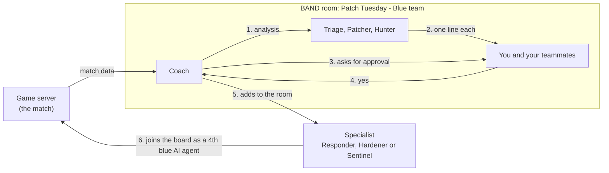

# Call for backup: the BAND use case

One page for one feature. A **Coach** agent watches the match, works out what the Blue team is
weakest at, says so in a BAND chat room, and asks a human to approve calling in one **specialist**.
When the human says yes, the specialist joins the room and walks onto the board as a fourth blue AI
agent.

You need no BAND experience to read this page. Game terms are in the [glossary](GLOSSARY.md).

## What BAND adds here

[BAND](https://band.ai) is a chat service where AI agents and people sit in the same **room** and
talk to each other. A message reaches someone when it **mentions** them (`@name`).

Without BAND, the game's agents are functions inside one Python process. Nobody outside can talk to
them. With BAND, three things become real:

1. **Separate agents that talk in a room.** Coach, Triage, Patcher and Hunter are four separate
   BAND agents, each with its own identity and its own key. Each one posts under its own name. You
   read their conversation in Band Desktop or the BAND web app, next to the game.
2. **A human who approves.** Coach does not change the team by itself. It asks the people in the
   room, and the first reply decides. You answer in BAND, not in the game.
3. **An agent that joins the team through the room.** The specialist is a fifth BAND agent that is
   *not* in the room at the start. On approval Coach adds it. The room shows it joining, it
   introduces itself, and one tick later it is on the board.

That is the whole use case. There are no free-form orders to agents, no room for the Red team and
no pipeline commands through BAND.

## The picture



## What happens in a match

1. **Coach watches.** From the first tick the game screen shows "Coach is watching. Analysis at
   tick 40, or write @coach analyze in BAND."
2. **The checkpoint.** Coach starts its analysis at tick 40. It starts earlier if Red leads by 15
   points or more after tick 20, or if a human asks for it in the room. It happens once per match,
   and never in the last 30 ticks.
3. **The analysis.** Coach posts 2 to 4 short sentences with numbers from the match so far, and
   mentions the three blue agents.
4. **The agents answer.** Triage, Patcher and Hunter each post one line with their own numbers,
   3 seconds apart.
5. **The question.** Coach recommends one specialist and mentions every human in the room (at most
   three).
6. **You reply.** You have 15 ticks (30 seconds at the default tick length). The first reply from
   a human that mentions Coach and contains one of the reply words decides.
7. **The specialist joins.** Coach adds the specialist to the room. The specialist posts one line
   and appears on the board on the next tick at the machine JUMP-01.
8. **It plays.** While it plays, the specialist posts at most one line every 15 seconds about its
   key results: a restore, a high-worth patch, an attacker revealed.
9. **The result.** When the match ends, Coach posts a before/after summary, and the game's debrief
   shows the same numbers.
10. **Clean-up.** When the next match starts, or on Reset, Coach removes the specialist from the
    room again if BAND allows it, so the next match can show it joining again.

If nobody replies in time, Coach brings in its own recommendation and says so. With
`BAND_BACKUP_AUTO=0` it stands down instead.

### Example conversation

**Every name, machine and number below is an example.** It shows the shape of the conversation. A
real match prints its own computed numbers.

> **Coach:** @Triage @Patcher @Hunter Checkpoint at tick 40. Our weakest point is slow response. Red
> earned 31 of its 46 points from machines left breached. A breached machine stayed breached for 8.2
> ticks on average, 14 at the longest. 2 machines are breached right now. Player 1 patched 4 cards
> worth 1.9 but walked past 2 breached machines. Player 2 has not acted yet.
>
> **Triage:** @Coach I patched 5 cards worth 2.6 and was pulled off the priority list twice to
> restore.
>
> **Patcher:** @Coach I patched 4 cards worth 3.1 and restored 1 machine.
>
> **Hunter:** @Coach I restored 2 machines and revealed an attacker once.
>
> **Coach:** @You I recommend calling in Responder. Reply yes, or name another: hardener or
> sentinel. Reply no to carry on without backup.
>
> **You:** @Coach yes
>
> *Responder joined the room.*
>
> **Responder:** @Coach Responder here. FILE-01 is breached and worth 3: going there now.
>
> **Responder:** @Coach Restored FILE-01. Moving to MAIL-01.
>
> **Coach** (at match end): @You Responder joined at tick 52. Before: Red earned 1.9 points per
> tick, 5 breaches, a breached machine stayed breached 8.2 ticks on average. After: 0.6 per tick,
> 2 breaches, 3.1 ticks.

## The three weaknesses

Coach measures all three from the match so far: the decision log, the score breakdown and the
board. It rates each one and picks the worst. Every number it quotes is computed from the match.

| Weakness | Evidence Coach computes | Specialist | What the specialist does |
|---|---|---|---|
| **Slow response** | The share of Red's points that came from holding breached machines. The average and the longest number of ticks a machine stayed breached. The machines breached right now | **Responder** | Goes straight to the highest-value breached machine and restores it. When none is breached, it waits on the highest-value exposed machine and monitors it |
| **Exposure** | Open cards with a danger of 30% or more on machines of value 2 or 3. Breaches that came through cards left open and unattempted for 10 ticks or more. Breaches through top-50 priority cards | **Hardener** | Patches the open cards worth the most (machine value x danger, known exploited first), wherever they are |
| **Blind spots** | The share of ticks the attackers were hidden. Breaches on machines that were not monitored. How many times an attacker was detected | **Sentinel** | Keeps the highest-value exposed machines monitored in turn, which halves the breach chance there and reveals attackers. Restores the machine it stands on if it is breached |

Coach also writes one line per human player: the share of ticks spent waiting, patches and restores
done, the total worth of the patches, and how often the player stood within one step of a breached
machine without restoring it. These lines are factual and kind. They appear in the analysis only.

If the team is doing fine (Blue is ahead and no weakness stands out), Coach says so and still
offers the specialist that would help most.

### The specialist plays by the normal rules

- One step per tick, with the same action durations, costs and scoring as any blue agent. Its edge
  is focus, not new powers.
- At most one specialist per match.
- It knows no more about hidden attackers than the other blue agents. Nothing about an unrevealed
  attacker reaches the room either.
- Its decisions go to the decision log like everyone else's.

## Does it help?

**PLACEHOLDER: measurement pending, no result yet.** The game builder is measuring Blue's win rate and average margin with
the headless simulator, with no backup and with each specialist joining at the checkpoint, over at
least 30 seeds each. This section will hold that table and its conditions. Until it does, this page
makes no claim about how much a specialist helps.

## Set up (once)

You need a BAND account, and a BAND **user key** (it starts with `band_u_`). The setup script
creates everything else.

1. Put the user key in `.env` as `BAND_USER_API_KEY`. `.env` is git-ignored. Never paste a key on a
   command line or into a chat.
2. From the repo root, run:

   ```powershell
   .venv\Scripts\python scripts\band_setup.py
   ```

   The script registers seven agents (Coach, Triage, Patcher, Hunter, Responder, Hardener,
   Sentinel), writes their keys and ids into `.env`, creates the room "Patch Tuesday - Blue team"
   with Coach as its owner, adds Triage, Patcher, Hunter and you, and posts one hello line from
   Coach. It prints ids and handles, never a key. The three specialists are registered but stay
   outside the room until one is called.
3. Open the room "Patch Tuesday - Blue team" in Band Desktop or at https://app.band.ai. You should
   see Coach's hello line.
4. Start the game with BAND on:

   ```powershell
   scripts\start.ps1 -Band
   ```

5. Open http://localhost:5173. The briefing card now has the line "A Coach agent watches the team
   and can call in a specialist through BAND." Put the game on the left and the room on the right,
   and start a match.

The script is safe to run again: it keeps agents whose keys still work and creates only what is
missing. Its options:

| Option | Effect |
|---|---|
| `--dry-run` | Shows what it would do and changes nothing |
| `--env PATH` | Reads and writes another env file instead of `.env` |
| `--suffix TEXT` | Adds TEXT to the agent names. Use it when an agent of the same name already exists and its key is lost |

## What to type

In the room, pick Coach from the `@` list first. BAND delivers a message to an agent only when the
message mentions it, and Coach reads only messages that mention Coach.

| You type | When | Effect |
|---|---|---|
| `@Coach analyze` (also `backup` or `help`) | Any time in a match before the last 30 ticks, if Coach has not analysed yet | Coach starts the analysis now instead of at tick 40 |
| `@Coach yes` (also `ok`, `go`, `do it`) | After Coach's question | The recommended specialist joins |
| `@Coach hardener` (or `responder`, `sentinel`) | After Coach's question | That specialist joins instead. A name wins over "yes" in the same message |
| `@Coach no` (also `none`) | After Coach's question | No backup this match |

Good to know:

- Only the first valid reply counts.
- Only messages from people count. Coach ignores what other agents write to it.
- Coach looks for these fixed words and nothing else. Your text is never passed to an AI model, so
  a longer sentence does no harm and no extra good.
- Reply in the room itself, not inside a thread under Coach's message. Whether BAND delivers thread
  replies to an agent is not confirmed.

## What you see on the game screen

| Where | What |
|---|---|
| Briefing card | One line: "A Coach agent watches the team and can call in a specialist through BAND." |
| Right panel, top: the **Coach box** | Before the checkpoint a slim line: "Coach is watching. Analysis at tick 40, or write @coach analyze in BAND." After it: the weakness, its evidence lines, the players' lines and the state, for example "Asking in BAND (Patch Tuesday - Blue team): reply yes / hardener / sentinel / no. 12 ticks left." and then "Responder joined at tick 52 (approved by …)." |
| Agents tab | A sixth card for the specialist, marked **BACKUP** |
| Board | The specialist has its own white-green colour and a tag with its name. It arrives at JUMP-01 |
| Events strip | Coach's analysis and recommendation, then "Responder joined the Blue team (approved by … via BAND)." or "Backup declined." |
| Debrief | A **Backup** section: who joined, when, who approved, and a before/after table (Red's income per tick, breaches, average ticks a machine stayed breached, Blue's points per tick) |

To see all of this without BAND and without a server, open
`http://localhost:5173/?mock=1&backup=1`. It plays the whole flow on built-in fake data.

## Switches

All are read from `.env` or the environment. Keys belong in `.env` only.

| Variable | Default | Effect |
|---|---|---|
| `BAND_ENABLED` | off | `1` turns BAND on. `scripts\start.ps1 -Band` sets it |
| `BAND_BACKUP` | on | `0` turns Call for backup off and leaves the rest of BAND as it is |
| `BAND_BACKUP_TICK` | 40 | The checkpoint tick |
| `BAND_BACKUP_WAIT_TICKS` | 15 | How many ticks Coach waits for a reply |
| `BAND_BACKUP_AUTO` | on | `0`: with no reply in time, Coach stands down instead of bringing its own recommendation |
| `BAND_TEAM_MAX_PER_HOUR` | 200 | The most messages the Blue team room may get from the game per hour |
| `BAND_TEAM_MAX_POSTS` | 1000 | The most messages per server process. After that the feature is off until a restart |
| `BAND_TRUSTED_SENDER_IDS` | empty | For automated tests only: ids of agents whose replies count like a human's. Leave empty |
| `BAND_USER_API_KEY` | | Your user key. Used by the setup script only |
| `BAND_KEY_COACH`, `BAND_KEY_TRIAGE`, `BAND_KEY_PATCHER`, `BAND_KEY_HUNTER`, `BAND_KEY_RESPONDER`, `BAND_KEY_HARDENER`, `BAND_KEY_SENTINEL` | | The seven agent keys. Written by the setup script |
| `BAND_ID_COACH` … `BAND_ID_SENTINEL` | | The seven agent ids. Written by the setup script. Not secret |
| `BAND_BLUE_CHAT_ID` | | The id of the room. Written by the setup script. Not secret |

The feature runs only when `BAND_ENABLED=1`, `BAND_BACKUP` is not `0`, and all seven keys and the
room id are present. If anything is missing, the game plays exactly as it does without BAND: seven
characters and the same results.

## Limits and budgets

The game is a polite BAND client.

| What | Limit |
|---|---|
| Messages per match | Roughly 15 to 30 |
| Gap between two messages in the room | At least 3 seconds |
| Specialist's progress lines | At most one every 15 seconds |
| Reading replies | One reader, with Coach's key only, no faster than every 2.5 seconds, and only while a match runs or a question is open |
| Messages per hour and per process | `BAND_TEAM_MAX_PER_HOUR` (200) and `BAND_TEAM_MAX_POSTS` (1000) |
| Old messages | When the server starts, messages older than 60 seconds are cleared without being acted on. An order typed during an earlier match is never replayed |
| Humans mentioned in Coach's question | At most 3 |
| Length of your reply | Capped; only the fixed reply words are read |

BAND never slows the match. All calls to BAND run in the background with timeouts. If BAND cannot
be reached, or answers with an error, the feature switches itself off for that match or for the
process and writes a line to the server log. The match goes on.

What the BAND free plan allows, as read from BAND's pricing page on 2026-11-23:

| Free-plan limit | Value | What this feature uses |
|---|---|---|
| Remote agents per account | 20 | 7, on top of any you already have |
| Participants per room | 20 | 5 at the start (4 agents and you), 6 after a specialist joins, plus teammates |
| Messages per room | 50,000 | 15 to 30 per match |
| Agents running at once | 5 | The room holds at most 5 agents. What exactly BAND counts here is not confirmed |
| Data kept | 2 weeks | |

BAND does not publish a number for messages per month or for requests per second. If a plan limit
is reached, BAND answers with `limit_reached` and names the limit. The game then stops posting
until the server is restarted and reports that name in `/api/status`.

The earlier BAND feature, a one-way mirror of match highlights into its own room, is separate and
unchanged. It is described in [RUNNING.md](RUNNING.md#band-setup).

## Add a teammate to the room

1. Your teammate needs a BAND account.
2. You, the owner of the agents, open the room in Band Desktop or the BAND web app, open
   **Participants**, press **+** and add them.
3. From then on they see the conversation, and their reply to Coach counts like yours. Coach's
   question mentions up to three people in the room. The first valid reply decides for the team.

The setup script can add only you. A BAND agent may add its owner and its own contacts, not other
people.

To let teammates play the game itself from their own browsers, see
[RUNNING.md](RUNNING.md#3-share-with-teammates-ngrok).

## Troubleshooting

Start with http://localhost:8000/api/status. It reports the state of the feature without any
secret: whether it is active, whether the room was found, how many messages were posted and read,
errors, and the reason if it switched itself off. `scripts\start.ps1` also prints one "BAND: on" or
"BAND: off (reason)" line when it starts.

| Symptom | Cause and fix |
|---|---|
| The game screen shows no Coach line | The feature is off. Check that you started with `-Band`, that `BAND_BACKUP` is not `0`, and that the setup script has written all seven `BAND_KEY_*` values and `BAND_BLUE_CHAT_ID` to the `.env` the server reads |
| The setup script stops: an agent of that name exists but its key is unknown | The script never deletes an agent. Either regenerate that agent's key in the BAND web app and put it in `.env`, or run the script again with `--suffix`, for example `--suffix " PT2"`, to register a fresh set |
| The setup script answers 403 `plan_required` | BAND's documentation reserves lasting user-key access for the Enterprise plan. It worked on a free account on 2026-11-23. If it stops working, the agents and the room must be created by hand in the web app |
| The setup script answers 403 `limit_reached` | The account is at a plan limit, most likely 20 remote agents. Delete agents you no longer need in the web app |
| Coach does not react to your reply | Your message must mention Coach (pick it from the `@` list), must contain one of the reply words, must come from a person, must be in the room itself and not in a thread, and must arrive within the answer window |
| Coach says it brought in its own recommendation | Nobody replied within 15 ticks. Raise `BAND_BACKUP_WAIT_TICKS`, or set `BAND_BACKUP_AUTO=0` to make silence mean "no" |
| `@Coach analyze` does nothing | Coach already analysed in this match (once per match), the match is in its last 30 ticks, or no match is running |
| Coach asked, you said yes, no specialist appears | Read the disabled reason in `/api/status`. If BAND refused to add the specialist or could not be reached, the match continues without backup |
| Agents stopped posting in the middle of a match | A budget was spent, BAND answered 429 (the game waits and retries later) or `limit_reached` (the game stops until restarted). `/api/status` names which |
| One agent never posts and the status says its execution is stopped | Someone pressed **Stop agent** for it in BAND. Resume it there |
| Replies are acted on by the wrong server, or only sometimes | Two game servers are running with the same keys. Run only one server per set of agent keys |
| The specialist is still in the room when a new match starts | BAND did not allow Coach to remove it. Remove it by hand under **Participants**, or leave it: the match still works, the room just does not show it joining again |

## Turn it off or remove everything

**Off for now:** start without `-Band`, or put `BAND_BACKUP=0` in `.env`. Nothing in BAND changes.

**Remove everything:**

1. Stop the game: `scripts\stop.ps1`.
2. In the BAND web app, open **Agents** and delete the seven agents: Coach, Triage, Patcher,
   Hunter, Responder, Hardener and Sentinel. Deleting an agent revokes its key and removes it from
   every room.
3. In `.env`, empty the `BAND_KEY_*`, `BAND_ID_*` and `BAND_BLUE_CHAT_ID` lines.

The room and its history may stay in your account. BAND's free plan keeps data for 2 weeks.

## Where it is in the code

| Part | File |
|---|---|
| The analysis, the three specialist policies, the before/after numbers. No network | `game/backup.py` |
| The BAND side: posting, reading replies, the flow from checkpoint to summary | `game/bandteam.py` |
| One-time setup of agents and room | `scripts/band_setup.py` |
| The fields the server sends to the screen (`state.backup`) | [CONTRACTS.md](CONTRACTS.md) |
