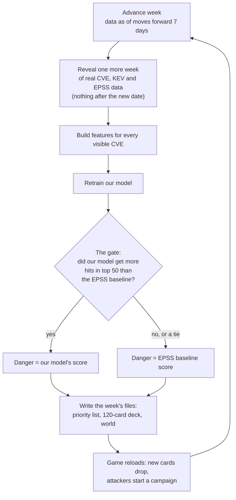

# How it works

A five-minute mental model for an engineer who is not a security or machine-learning specialist.
To play, read [PLAY.md](PLAY.md). For the data pipeline, read [PIPELINE.md](PIPELINE.md). For the
model and its test, read [MODEL_AND_GATE.md](MODEL_AND_GATE.md). Every term is in
[GLOSSARY.md](GLOSSARY.md).

Four words first:

- A **CVE** is one publicly recorded software vulnerability, with an id such as `CVE-2025-34291`.
- **Known exploited (KEV)** means the CVE is on the US agency CISA's list of vulnerabilities that
  attackers have really used.
- The **EPSS baseline** is a public, industry-standard score that estimates how likely a CVE is to
  be exploited.
- **Our model** is a small model this project retrains every simulated week to do the same job.

## 1. Three loops

**A tick (2 seconds).** The game has 20 machines on a 5 x 4 grid and seven characters: two human
defenders, three AI defenders and two hidden AI attackers. Every tick, each character takes exactly
one action: move, patch, monitor, isolate, restore, scan, attack or wait. The server resolves all
seven actions, updates the scores and writes one row per character to the decision log.

**A match (150 ticks, 5 minutes).** A match deals real CVEs onto the machines as **cards**. Each
card has a **danger**: its predicted chance of being exploited. Red scores by breaking into
machines and holding them. Blue scores by patching dangerous cards before Red tries them and by
restoring breached machines. After 150 ticks the higher score wins, and the game shows which cards
were really exploited later.

**A week (one press of Advance week).** The button moves the simulated "today" forward 7 days and
re-runs the real data pipeline (Bruin on DuckDB) for that week. It takes about 20 to 30 seconds and
the match keeps ticking. The pipeline reveals that week's real vulnerability data, retrains our
model, tests it against the EPSS baseline, and writes new danger scores. New cards drop onto the
board and the attackers go after them.



## 2. The trick

All the data was downloaded once, on **2026-11-23**. The game starts on **2026-03-22**. The pipeline
keeps a date called **data as of**, and it hides every record dated after it. Features, training
and scoring read only the cut-down copy, so for them the future does not exist.

That gap of eight months is the point. The pipeline can make a prediction in "March" with only what
was public in March. The answer (which CVEs really became known exploited) is already sitting in
the full download. So every prediction can be checked later against what really happened. The
replay covers day 0 (2026-03-22) plus 12 weekly advances, up to 2026-06-14.

Only one part of the pipeline is allowed to read the future: the file that powers the
end-of-match reveal. Nothing else reads that file.

## 3. The life of one card: CVE-2025-34291 (Langflow)

All values below come from the pipeline's output files for the week with data as of **2026-03-29**
(pipeline run `2026_11_23_13_24_43`), unless marked otherwise.

**Station 1: the public record.** CVE-2025-34291 was published on **2025-12-05**. It affects
Langflow, a tool for building AI workflows. Its weakness class is CWE-346 (origin validation error)
and its severity score (CVSS) is 8.8, HIGH. The game never sees the description text, exploit code
or links. A card carries only the vendor, product, weakness class, severity, scores and KEV status.

**Station 2: becoming visible.** The pipeline shows a CVE only when its publication date is on or
before the data-as-of date. This one was published before the game's first day, so it is visible
from day 0. By the week of 2026-03-29 it is 114 days old. It is one of **188,844** visible CVEs
(1,627 of them new that week). It is **not** known exploited yet: KEV listed 1,554 visible CVEs
that week, and this was not one of them.

**Station 3: two scores.** Both scorers answer "how likely is this to be exploited?"

| Scorer | Score for this CVE, week of 2026-03-29 |
|---|---|
| EPSS baseline | 0.152 (15%). EPSS's own percentile: 94.6 |
| Our model (`hgb-2026-03-29`) | 0.319 (32%) |

Our model rated it about twice as dangerous as the baseline did.

**Station 4: priority.** The pipeline sorts every visible CVE by the score in use that week. That
is the patch-priority list. This CVE is **priority #41 of 188,844**. That is unusually high for a
CVE not yet known exploited.

**Station 5: the gate.** Before our model's scores may be used, the model must beat the EPSS
baseline on a test with known answers. The pipeline goes back 91 days, lets both scorers pick their
50 most dangerous CVEs from about 172,912 candidates, and counts how many picks really became known
exploited in those 91 days. There were 32 such CVEs to find. Result: **our model 2 hits in top 50,
EPSS baseline 0**. The gate passed, so the model was promoted and its score (0.319) became this
card's danger. Had the gate failed, the danger would have been the EPSS score (0.152).

**Station 6: becoming a card on a machine.** The pipeline builds a 120-card deck each week. This
CVE is card 37: "Langflow: origin validation error", danger 32%, priority #41. When a match starts,
the game shuffles the deck and deals 2 or 3 cards onto each machine, so only part of the deck is on
the board. Which machine gets this card depends on the match's random deal, so it is not on the
board in every match. Machines have a value of 1, 2 or 3. Suppose it lands on ERP-01 (value 3).
Patching it before Red tries it is then worth value x danger = 3 x 0.319 = **+0.96** for Blue.

**Station 7: danger becomes breach chance.** When an attacker attacks a machine through a card,
the game rolls dice. The **breach chance** is built from the danger in five steps (the exact
formula is in `game/rules.py` and [CONTRACTS.md](CONTRACTS.md)):

1. **Amplify the danger.** A match is short, so one attack counts as six independent tries:
   base = 1 - (1 - danger)^6. A danger of 2% becomes 11%; a danger of 32% becomes 90%.
2. **Add bonuses.** +15 points if the card is known exploited. +10 points if this attacker
   scanned the machine first.
3. **Apply the patch state.** x1 if unpatched, x0.4 while a patch is in progress, x0 once patched.
4. **Apply monitoring.** x0.5 if a defender is monitoring the machine.
5. **Limit it.** Never above 95%. Always 0 on an isolated machine.

Worked number for this card: danger 0.3185, so 1 - 0.3185 = 0.6815, and 0.6815^6 = 0.100. Base =
1 - 0.100 = **0.90**. Not known exploited, not scanned, unpatched, not monitored: breach chance
**90%**. The game then draws a random number from 0 to 1, and the attack succeeds if it is below
0.90.

| Situation for this card | Breach chance |
|---|---|
| Unpatched, nobody watching | 90% |
| Attacker scanned first (0.90 + 0.10, limited) | 95% |
| A defender is monitoring (0.90 x 0.5) | 45% |
| A patch is in progress (0.90 x 0.4) | 36% |
| Patched, or machine isolated | 0% |
| Same card if EPSS set the danger (0.152) | 63% |

The last row shows why the gate matters to the game: the choice of scorer changes the dice.

**Station 8: the decision-log row.** Every action writes one row with the danger used, where it
came from, the breach chance, the roll and the outcome. **What is missing:** the saved decision log
(`ledger/ledger.jsonl`, 8,169 rows when this was written) has no attack or patch row for
CVE-2025-34291, so the card was either not dealt or not acted on in those matches. Here instead is
a real row from the same week for a different card with a similar danger (some fields left out):

```json
{"world_asof": "2026-03-29", "model_version": "hgb-2026-03-29", "tick": 11,
 "actor_id": "red2", "action": "EXPLOIT", "node_id": 19, "cve_id": "CVE-2025-54920",
 "score_used": 0.245759, "score_source": "model", "p_breach": 0.915897, "roll": 0.288152,
 "outcome": "breach",
 "reason_text": "Patient exploits CVE-2025-54920 on JUMP-01: scanned 1 ticks ago, 13 days old, est. odds 0.92 over its bar of 0.57."}
```

You can check it by hand: danger 0.2458 gives a base of 0.816, plus 0.10 because the attacker
scanned first, equals 0.916. The roll 0.288 is below 0.916, so the machine was breached. The row
also names the model version and the data-as-of date, so any breach can be traced back to the
pipeline run that set the danger.

**Station 9: what really happened.** CISA added CVE-2025-34291 to the known-exploited list on
**2026-05-21**, 53 days after this board's date and inside the 91-day window. In the week of
2026-03-29 nothing in the pipeline could see that. Our model had put it at #41 of 188,844. At the
end of a match the debrief shows this for every card on the board that really became known
exploited, and whether you patched it, lost a machine through it or left it open.

One correct call does not prove the model is good. Section 6 says how much weight it can bear.

## 4. What the gate is and why it matters

A retrained model can be worse than the one before it. The **gate** is the pipeline check that
stops a worse model from reaching the game. Every week:

1. Go back 91 days, to a date whose answers are now known.
2. Both scorers rank the same candidates, using only what was visible then.
3. Count each scorer's **hits in top 50**: of its 50 top picks, how many really became known
   exploited in those 91 days.
4. Our model is promoted only if it has **strictly more** hits than the EPSS baseline. A tie fails.

The gate is a blocking check inside the pipeline, not a number on a dashboard. When it fails, the
pipeline skips the promotion step, and the week's files are rebuilt with EPSS scores. The game
keeps running; the badge on the screen switches from MODEL to EPSS and every card's danger comes
from the EPSS baseline that week.

It has really failed twice in this replay:

| Data as of | Our model | EPSS baseline | Bugs to find | Result |
|---|---|---|---|---|
| 2026-03-22 (day 0) | 0 | 0 | 31 | Blocked (tie). EPSS sets the danger. |
| 2026-05-17 | 0 | 1 | 41 | Blocked. EPSS sets the danger. |

In the other 11 weeks the model passed, with 2 to 5 hits against 0 or 1.

Why it matters: this is the part of the project a real team could reuse. A model earns its place
each week on a test it could not have seen, and the fallback is automatic. If any *other* check
fails (for example a data-leak check), the pipeline does not fall back to EPSS: it stops, reports
the failed check and the game keeps the last good week.

## 5. What is real and what is a game

| Real | A game |
|---|---|
| Every CVE, its publication date, vendor, product and severity (from the US NVD database) | The 20-machine network, the machine names and their values |
| The EPSS baseline scores, as published for each date | The seven characters and how the AI ones decide |
| The KEV list and the date each CVE joined it | Attacks: abstract moves, no exploit code anywhere |
| Our model, its weekly retraining and its scores | The breach dice and the "six tries" formula |
| The gate and its results, including the two failures | Points, patch times and the 5-minute clock |
| The end-of-match reveal of what was exploited later | Which machine a card lands on |

A high danger is a real prediction about a real CVE. A breach in the game is a dice roll shaped by
that prediction. It says nothing about any real system.

## 6. Limits

Read the results with care. Three things limit them.

**The margins are small.** Becoming known exploited is rare: about 30 to 45 CVEs out of roughly
170,000 to 185,000 candidates in any 91-day window. Our model wins a week by 1 to 5 CVEs in its top
50. Differences that small are noisy.

**The test suits our model.** The gate asks "will this join the KEV list within 91 days?". EPSS
was built for a different question (exploitation activity within 30 days). Beating EPSS here does
not mean our model is the better exploit predictor in general.

**One known leak remains.** The CVE details from NVD (severity, weakness class, vendor, product,
keyword flags) are as they stood on the download date, 2026-11-23, not as they stood on each
simulated date. NVD analyses known-exploited CVEs first, so those fields carry a little
information from the future. The project measures this every week by retraining without those
fields: over the 12 advances the model's total hits fall from 36 to 27, against 8 for EPSS, and it
still beats EPSS in 9 of 12 weeks instead of 11. That is an upper bound on the leak, because
removing the fields also removes honest signal. EPSS scores and KEV dates are exact for each date.

The full tables, the leak checks and the proof that the gate blocks are in
[MODEL_AND_GATE.md](MODEL_AND_GATE.md).
