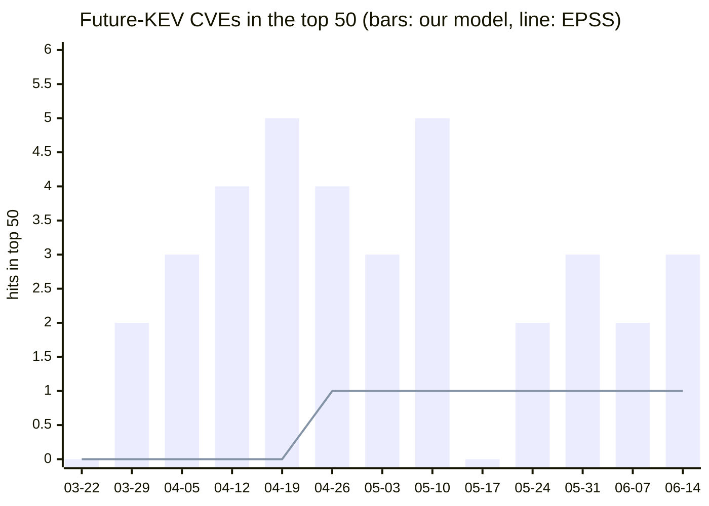
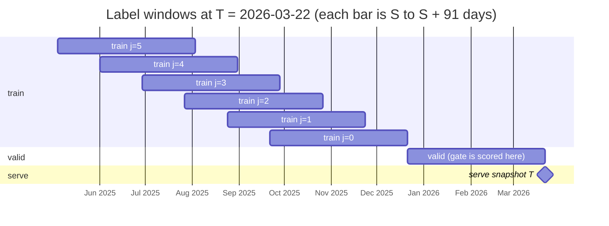
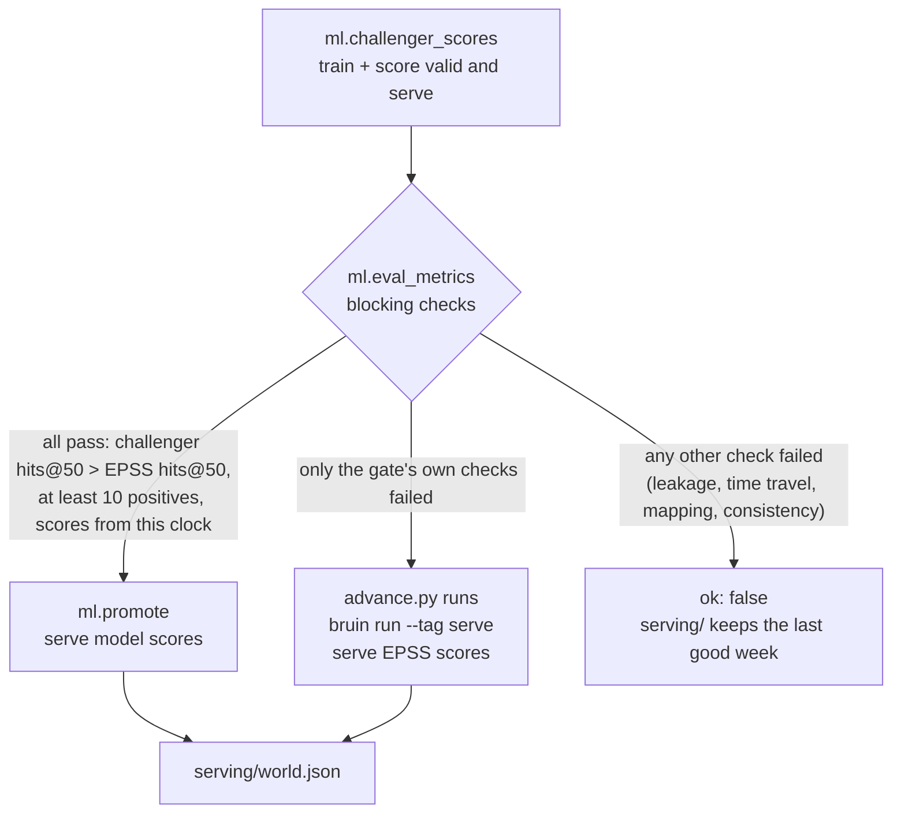

# The model and the gate

In five lines:

1. Every simulated week the pipeline retrains **our model**. It predicts which software bugs (CVEs)
   will become **known exploited (KEV)**, meaning added to CISA's Known Exploited Vulnerabilities
   list, within 91 days.
2. The **EPSS baseline** is the public industry-standard score for the same kind of question.
3. Both are tested on a past week whose outcome is already known: each names its 50 most dangerous
   bugs, and we count how many really became known exploited. That count is **hits in top 50**.
4. **The gate** is a blocking check in the Bruin pipeline. Our model replaces EPSS for the week only
   if it has strictly more hits. A tie keeps EPSS.
5. Whichever wins sets the **danger** on every card in the game for that week.

**Result.** Over 12 replayed weeks our model passed the gate 11 times and was blocked once
(2026-05-17, 0 hits against 1). On day 0 it was also blocked, by a 0-0 tie. Total hits over the 12
weeks: our model 36, EPSS baseline 8. The margins are small (1 to 5 bugs a week) and come with
caveats, all listed below. Do not skip [Read this honestly](#read-this-honestly).

Naming: in code, asset names and logs, our model is the "challenger", hits in top 50 is `hits@50`
or `precision@50` / `p@50` (hits divided by 50), and the gate is the "promotion gate". Other terms
are in the [glossary](GLOSSARY.md). How Bruin runs all this is in [PIPELINE.md](PIPELINE.md).

## Results: the gate, all 12 weeks (bruin backfill, 2026-03-23 to 2026-06-14)

Generated by `bruin backfill pipelines/patch_tuesday --start-date 2026-03-23 --end-date 2026-06-14
--partition weekly --timezone UTC --on-failure continue --workers 1` after a day-0 reset (4m06s, one
child run per week, about 20 s each). "Hits" = validation positives in the top 50, out of about
172k-185k candidates.



"Positives" is the number of bugs in the test set that really became known exploited in the 91 days.

| Data as of | Positives | Our model: hits in top 50 | EPSS: hits in top 50 | Our model p@50 | EPSS p@50 | Gate |
|---|---|---|---|---|---|---|
| 2026-03-22 (day 0) | 31 | 0 | 0 | 0.00 | 0.00 | **fail** (tie) |
| 2026-03-29 | 32 | 2 | 0 | 0.04 | 0.00 | pass |
| 2026-04-05 | 32 | 3 | 0 | 0.06 | 0.00 | pass |
| 2026-04-12 | 32 | 4 | 0 | 0.08 | 0.00 | pass |
| 2026-04-19 | 36 | 5 | 0 | 0.10 | 0.00 | pass |
| 2026-04-26 | 43 | 4 | 1 | 0.08 | 0.02 | pass |
| 2026-05-03 | 44 | 3 | 1 | 0.06 | 0.02 | pass |
| 2026-05-10 | 42 | 5 | 1 | 0.10 | 0.02 | pass |
| 2026-05-17 | 41 | 0 | 1 | 0.00 | 0.02 | **fail** |
| 2026-05-24 | 36 | 2 | 1 | 0.04 | 0.02 | pass |
| 2026-05-31 | 38 | 3 | 1 | 0.06 | 0.02 | pass |
| 2026-06-07 | 36 | 2 | 1 | 0.04 | 0.02 | pass |
| 2026-06-14 | 32 | 3 | 1 | 0.06 | 0.02 | pass |

### Read this honestly

Precision@50 is tiny for both: about 0.02% of candidates enter KEV in any 91-day window. Our model
"wins" by 1 to 5 CVEs, and differences that small are noisy. EPSS ranks old, heavily scanned CVEs
highest, and those rarely enter KEV *newly*. Our model leans on KEV history (vendor and product KEV
counts) and recency, which suits this task. The task is "enters KEV within 91 days", not EPSS's own
target ("exploitation activity within 30 days"), so this compares the two on our model's home
ground. A week the model wins is not evidence that it is a better exploit predictor in general.

## How the model is trained and tested

Let T be the world clock (a Sunday; the screen shows it as "data as of") and H = 91 days (pipeline
variable `horizon_days`). A snapshot is the state of the world at one date.

| Role | Snapshot | Label |
|---|---|---|
| serve | T | none |
| valid | T - H | entered KEV in (T-H, T] |
| train (x6) | T - 2H - 28j, j = 0..5 | entered KEV in (S, S+H], all ending by T - H |

On day 0 (T = 2026-03-22) the label windows line up like this. No training window reaches past the
start of the validation window, and validation ends exactly at the clock:



- **Candidates** at snapshot S are CVEs in `raw.cves` published by S. Train and valid rows exclude CVEs
  already in KEV at S. Serve rows include them (flag `in_kev`) so the whole world can be scored.
- **Features** (28, all numeric): age; CVSS score, sub-scores and vector flags; EPSS, percentile and
  28-day delta as of S; vendor, product and CWE KEV counts as of S; vendor CVE count as of S; seven
  description keyword flags (code execution, unauthenticated, command injection, privilege
  escalation, auth bypass, deserialization, overflow). Exploitation-status words are not used.
- **Training** keeps every positive and a deterministic 5% hash sample of negatives. Negatives are
  re-weighted by 20 so scores stay near the base rate. HistGradientBoostingClassifier, hyperparameters
  fixed in advance (`max_iter=200, learning_rate=0.06, max_leaf_nodes=15, l2=1.0,
  min_samples_leaf=40, random_state=7`), never tuned on a validation snapshot. Rows are read in a
  fixed order so the run is deterministic.

## The gate

The gate is the asset `ml.eval_metrics` with blocking custom checks. Our model must find **strictly
more** future-KEV CVEs than EPSS in its top 50 of the same validation candidates, with EPSS taken as
of the validation snapshot. The validation set must also hold at least 10 positives, and the scores
must come from this clock.

If any check fails, Bruin skips `ml.promote` and every serve asset. `scripts/advance.py` then
rebuilds the serve assets with `bruin run --tag serve`, and they read `ml.promotions`, find no row
for this week and serve EPSS (`score_source: "epss"`, `model_score: null`).

It does this **only** when the gate's own three checks were the only failures. A failed leakage,
time-travel, mapping or consistency check anywhere upstream means `ok: false` with the failed check
names, and `serving/` keeps the last good week (the serve assets would otherwise read the tables
that run left behind). `serving/world.json` reports the gate numbers of the same run only
(`ml.eval_metrics` joined on the run id as well as the clock).



## Proving the gate blocks

There are two real failing weeks: day 0 (a 0-0 tie) and 2026-05-17 (0 vs 1). On day 0,
`python scripts/advance.py --day0` printed:

```
[advance]   x Assets executed      1 failed due to checks / 17 succeeded / 7 skipped
[advance]   ... custom check 'challenger beats EPSS on precision@50' has returned 0 instead of the expected 1
[advance] world.json did not move: rebuilding the serve assets in EPSS mode (bruin run --tag serve)
[advance]   ok Assets executed      6 succeeded
{"ok": true, "asof_date": "2026-03-22", "score_source": "epss", "challenger_p_at_50": 0.0, "epss_p_at_50": 0.0, "gate_passed": false, "message": "world at 2026-03-22: gate failed, serving EPSS (...); serve assets rebuilt in EPSS mode"}
```

A forced failure uses the clearly marked test switch `PT_DEGRADE_MODEL=1`. `advance.py` passes it as
`--var degrade_model=true`, and `ml.challenger_scores` then serves deterministic noise with
`model_version` set to `degraded-test-<asof>`. Run on week 2026-04-19, after the three weeks before it
had been promoted, it gave the following. The main run exited 1 with `UPSTREAM FAILED ml.promote` and
every serve asset skipped. `ml.promotions` still held only 03-29, 04-05 and 04-12. The `--tag serve`
rebuild wrote `world.json` with `score_source "epss"` and `model_version null`. All 120 cards and 500
priority rows showed `score_source "epss"` and `model_score null`. `advance.py` printed `gate_passed:
false` with the message suffix `[TEST SWITCH degrade_model=true]`. (These runs came before training
rows were ordered for determinism; the gate mechanism did not change.) Never set the switch in play.

**Re-running a week that was already promoted** goes through `advance.py --rerun`, which re-runs
the current window with a new run id and the same fallback rule. On 2026-03-29 (promoted, 2 vs 0):
`PT_DEGRADE_MODEL=1 python3 scripts/advance.py --rerun` failed the gate (0 vs 0), `ml.retract` removed
the promotion, and the `--tag serve` rebuild served EPSS: `world.json` showed `score_source "epss"`,
the new run id and that run's gate numbers, and 0 of 120 cards kept a `model_score`. A plain
`--rerun` promoted the week again. A bare `bruin run` of the same window does **not** do this: in
that test `ml.promotions` lost the 03-29 row while `serving/*.json` still said `score_source
"model"`, because a failed gate skips the serve assets and nothing rebuilt them. After a manual
`bruin run` whose gate failed, always run `bruin run --workers 1 --tag serve` for the same window,
or use `--rerun` instead.

## Leakage audit

"Leakage" means information from the future reaching the model, which would make its test result
too good. What prevents the future reaching a snapshot's features or the model:

1. **Structural.** `raw.*` holds no row dated after the clock. Blocking checks on `raw.cves`,
   `raw.kev` and `raw.epss` enforce this. Only `raw.*` read `landing.nvd_cves`, `landing.kev` and the
   EPSS files; `sim.reveal` reads `landing.kev` for the end-of-match file only.
2. **Labels.** y is computed from `raw.kev` only, and every train/valid label window ends by the
   clock (blocking check). Training windows end by T - H, so they never overlap validation.
3. **As-of features.** Every KEV and CVE aggregate filters on dates <= S. EPSS is the latest file
   dated <= S. Blocking checks: no candidate published after S, no EPSS file after S, no train/valid
   candidate already in KEV at S, every positive inside its window.
4. **Excluded fields.** `cisa*`, references, SSVC, `vulnStatus`, `lastModified`, description text,
   exploitation-status words and `mapping_source` are never features. The CTID mapping is used only
   for CVEs already in `raw.kev`, enforced by a blocking check.
5. **Time-travel test (`feat.fingerprints`).** The snapshot that is train j at clock T is train j+1
   at T+28. Each run stores an md5 of every training snapshot's feature and label rows, and a blocking
   check fails if one snapshot ever fingerprints differently at two clocks. `ml.challenger_scores`
   depends on it, so a leak stops the model. Over the 12-week backfill, 25 snapshot dates were
   fingerprinted at 2 to 4 different clocks, and all were identical.
6. **Independent audit** `tests/pipeline/leakage_audit.py`: 19 SQL checks, including relabelling
   from the full `landing.kev` mirror and recounting vendor KEV history from the mirror cut at S.
   Result after every advance and after the backfill: `leakage audit: 19 passed, 0 failed`.

### Residual leak: NVD enrichment

**NVD enrichment is as of the download date, and it is label-correlated.** CVSS
(the NVD Primary metric first), the CWE (NVD-sourced first), CPE vendor/product and the description
keywords come from records downloaded on 2026-11-23. Every train and valid record was modified
after its label window closed. This is not random noise: NVD analyses KEV CVEs first, so whether
these fields are filled, and with what, partly reflects the future label. The vendor, product and
CWE KEV counts are keyed on these fields too. `feat.fingerprints` cannot see this, because the
mirror is the same at every clock. `python3 tests/pipeline/nvd_enrichment_report.py` at day 0:

| Group | n | NVD-analyzed (Analyzed/Modified) | Deferred | CWE null | vendor null | modified after label end |
|---|---|---|---|---|---|---|
| valid, enters KEV | 31 | 1.000 | 0.000 | 0.000 | 0.000 | 1.0 |
| valid, does not | 172,029 | 0.858 | 0.142 | 0.093 | 0.010 | 1.0 |
| train, enters KEV | 133 | 1.000 | 0.000 | 0.045 | 0.000 | 1.0 |
| train, does not | 45,120 | 0.893 | 0.106 | 0.098 | 0.007 | 1.0 |

The NVD 2.0 feeds carry no CNA "affected" block, so vendor and product cannot be taken from CNA
data without another download (cvelistV5). Instead, `ml.sensitivity` measures the effect every week.
It retrains our model with the same hyperparameters on the same rows without any NVD-derived
feature (CVSS score, sub-scores and vector flags; vendor, product and CWE KEV counts; vendor CVE
count and ratio), keeping age, EPSS (level, percentile, 28-day delta) and the keyword flags. Then it
counts hits in top 50 on the same validation candidates. Over the 12-week backfill (2026-03-29 to 06-14):

| | Total hits in top 50 (12 weeks) | Weeks that beat EPSS |
|---|---|---|
| Our model as served (28 features) | 36 | 11 |
| Our model without NVD-derived features (11 features) | 27 | 9 |
| EPSS | 8 | |

Per week, masked vs full: 2/2, 4/3, 3/4, 3/5, 5/4, 2/3, 1/5, 2/0, 2/2, 1/3, 2/2, 0/3. Read it as an
upper bound on the leak, not a measurement of it: masking also removes real signal. Without the
NVD-derived fields our model's margin over EPSS shrinks from 28 to 19 hits (about a third), and the
weekly 1-to-5-hit margins should be read with that in mind. Without those fields our model still
beats EPSS in 9 of 12 weeks. The Rejected filter also uses the download-date status. EPSS and KEV
are exactly as of S.

## Known limits

- The NVD year feeds are organised by CVE-ID year, so CVEs with pre-2020 ids are not candidates even
  if published later. KEV history counts still include every KEV entry.
- NVD enrichment is as of the download date and correlated with the label (see the leakage audit
  and `ml.sensitivity` above).
- Our model's margin over EPSS is 1 to 5 CVEs in the top 50. That is small, noisy, and measured
  on a task (new KEV entries within 91 days) different from EPSS's own target.
- Replay range: day 0 2026-03-22 to 2026-06-14 (12 advances), fixed by the downloaded EPSS files.
  A blocking check refuses any other clock.
- Bruin-specific limits (seeds on `/mnt/c`, backfill and the EPSS fallback, `serving/` in git) are
  listed in [PIPELINE.md](PIPELINE.md#bruin-specifics-and-limits).
