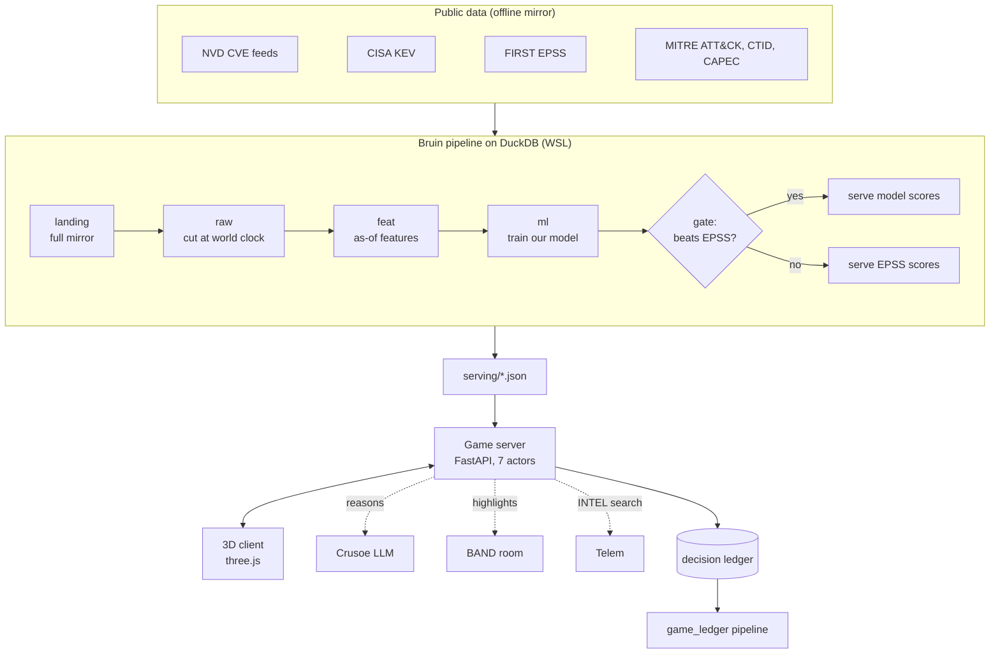
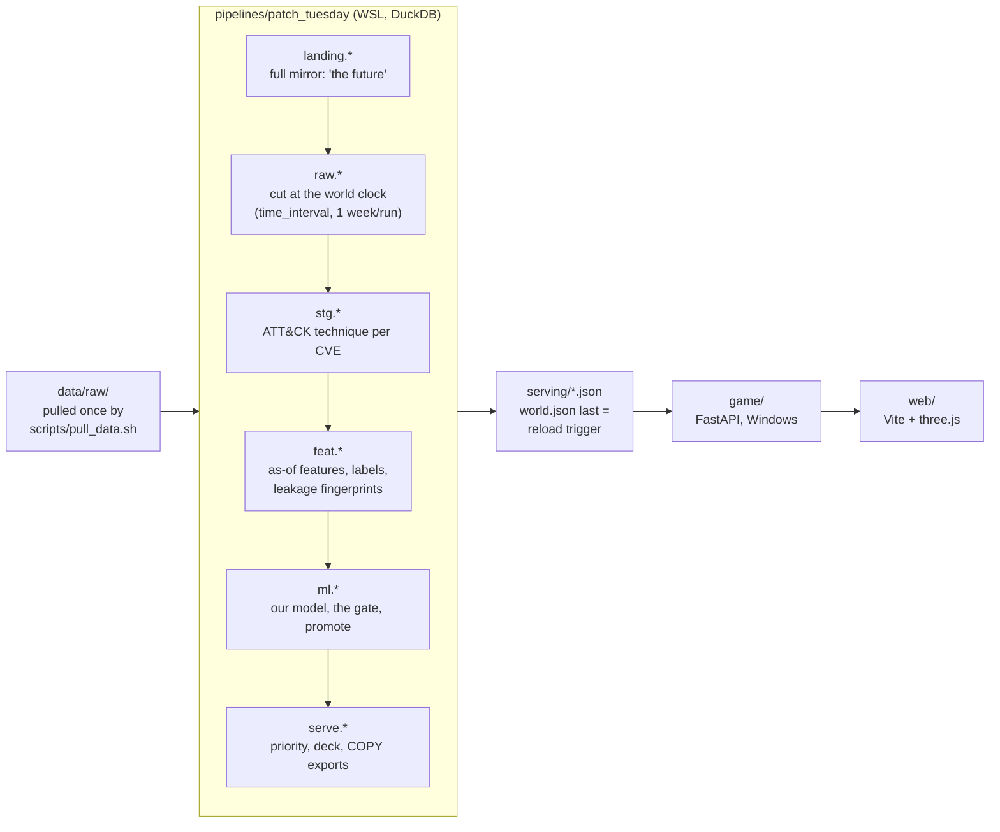
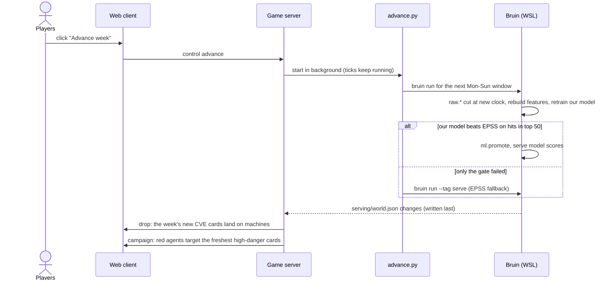

# The pipeline: how Patch Tuesday uses Bruin

[Bruin](https://getbruin.com) is a command-line tool for data pipelines: you write each table as a
SQL or Python file (an "asset"), and Bruin runs the assets in dependency order and runs quality
checks on each one. In this project Bruin is the referee: one blocking check, **the gate**, decides
whether the game serves danger scores from **our model** or from the **EPSS baseline**.

This page is for data engineers. Terms are in the [glossary](GLOSSARY.md). How the model and the
gate work is in [MODEL_AND_GATE.md](MODEL_AND_GATE.md). The commands are in [RUNNING.md](RUNNING.md).

## At a glance

The pipeline writes four JSON files into `serving/`. The game reads only those files. It never
opens the pipeline database. The file shapes are fixed in [CONTRACTS.md](CONTRACTS.md).

## Architecture

On screen, an advance shows these layers as seven steps: `landing › raw › stg › feat › ml › GATE ›
serve`. The GATE step is the asset `ml.eval_metrics`. The `sim.*` asset counts as part of serve.

## The world clock (the screen calls it "data as of")

The `raw.*` layer is the world clock. `landing.*` holds everything up to the download date (2026-11-23).
`raw.*` copies only rows dated on or before the run window end. Features, labels and the model read
only `raw.*`, so for them the future does not exist. The single exception is `sim.reveal`, which
reads `landing.kev` to write `serving/reveal.json` (did each deck CVE really enter KEV within 91 days?).
That file is shown only at the end of a match, and nothing in the pipeline reads it.

Each Bruin run covers one Monday-to-Sunday window. The Sunday is the clock. The replay range is
day 0, 2026-03-22, to 2026-06-14 (12 advances). It is fixed by the downloaded EPSS files, and a
blocking check refuses any other clock.

## One simulated week

Pressing **Advance week** moves the world forward seven days of real history while the match keeps
running:

`scripts/advance.py` uses the standard library only. It refuses to start while `data/.advance.lock`
is held, runs the next Monday-to-Sunday window, and decides the outcome from `serving/world.json`
(it moved when it has the new clock and a new run id) and from the checks Bruin reports as failed
(Bruin exits 1 for a failed gate and for any other failed check alike). If the file did not move
and only the gate failed, it runs the `--tag serve` rebuild; any other failure is `ok: false`. Its
last stdout line is the JSON result from [CONTRACTS.md](CONTRACTS.md). After 2026-06-14 it returns
`ok: false`. Full Bruin output goes to `logs/advance/`. The lock holds advance.py's pid; a lock
whose process is gone, or older than 2 hours, is stale and the next advance (or `reset.sh`) removes
it (`python scripts/advance.py --lock-status` prints the state).

## Assets (26 in `pipelines/patch_tuesday`, 1 in `pipelines/game_ledger`)

In asset names and code, "challenger" means our model and "precision@50" or "hits@50" means hits in
top 50.

| Layer | Asset | Kind / strategy | Purpose |
|---|---|---|---|
| landing | `landing.kev` | seed (`kev.csv`) | Full KEV catalogue, 1,790 rows |
| landing | `landing.cwe_names` | seed (`cwe_names.csv`) | Project-written weakness-class labels for card titles |
| landing | `landing.nvd_cves` | Python, create+replace, `enforce_schema` | NVD feeds flattened once on day 0 (284,810 rows); description text never stored, only 7 keyword flags |
| landing | `landing.attack_techniques` | Python, create+replace | ATT&CK 20.1 active techniques (706) |
| landing | `landing.kev_attack_map` | Python, create+replace | CTID KEV to ATT&CK mappings (1,183) |
| landing | `landing.cwe_attack_map` | Python, create+replace | CWE to CAPEC to ATT&CK pairs (567) |
| raw | `raw.world_clock` | SQL, create+replace | One row: asof_date, window_start, run id, horizon |
| raw | `raw.cves` | SQL, **time_interval** on published_date | CVEs visible at the clock (Rejected dropped) |
| raw | `raw.kev` | SQL, **time_interval** on date_added | KEV entries visible at the clock |
| raw | `raw.epss` | SQL, **time_interval** on score_date | EPSS files read straight from `.csv.gz` |
| stg | `stg.cve_technique` | SQL, create+replace | Technique + weakness class per CVE: kev_ctid, cwe_capec, heuristic, none |
| feat | `feat.snapshots` | SQL, create+replace | Snapshot calendar |
| feat | `feat.snapshot_features` | SQL, create+replace | (snapshot, CVE) features and label |
| feat | `feat.fingerprints` | SQL, **delete+insert** on asof_date | Time-travel leakage audit |
| ml | `ml.challenger_scores` | Python, create+replace | Train HistGradientBoosting, score valid + serve |
| ml | `ml.eval_metrics` | SQL, **delete+insert** on asof_date | precision@50 of our model and EPSS; **the gate** (blocking custom checks) |
| ml | `ml.promotions` | SQL, **ddl** | Promotion registry, never dropped |
| ml | `ml.retract` | SQL, unmaterialised DELETE | Withdraws a stale promotion for the clock before the gate runs |
| ml | `ml.promote` | SQL, unmaterialised INSERT | Runs only if every gate check passed |
| ml | `ml.sensitivity` | Python, **delete+insert** on asof_date | Diagnostic: the gate re-run without NVD-derived features (never blocks a week) |
| serve | `serve.patch_priority` | SQL, create+replace | Every visible CVE ranked by the served score |
| serve | `serve.attack_cards` | SQL, create+replace | The 120-card deck |
| serve | `serve.export_cards` / `export_priority` | SQL, single COPY | `serving/attack_cards.json`, `patch_priority.json` |
| sim | `sim.reveal` | SQL, single COPY | `serving/reveal.json` |
| serve | `serve.export_world` | SQL, single COPY | `serving/world.json`, last, the game's reload trigger |
| game | `game.agent_ledger` | seed (`ledger/ledger.jsonl`, jsonl) | The game's decision ledger, on demand, separate pipeline |

`bruin lineage pipelines/patch_tuesday/assets/serve/export_world.sql` (add `--full` for transitive)
prints the dependency graph.

Day-0 row counts: landing.nvd_cves 284,810 · raw.cves 187,217 · raw.kev 1,551 · raw.epss 15,656,918
(53 files) · stg.cve_technique 187,217 · feat.snapshot_features 404,530 (serve 187,217, valid
172,060, train 45,253 with 133 positives) · ml.challenger_scores 359,277 · serve.patch_priority
187,217 · serve.attack_cards 120.

## Bruin feature map

| Bruin feature | Where |
|---|---|
| SQL assets with header metadata | every `.sql` under `assets/` |
| Python assets, `materialize()` into DuckDB, `enforce_schema` | `landing/*.py`, `ml/challenger_scores.py` |
| `from bruin import query` | `ml/challenger_scores.py` |
| Python requirements via uv (`image: python:3.12`) | `pipelines/patch_tuesday/requirements.txt` |
| Seeds (CSV, JSONL) | `landing/kev_seed.sql`, `landing/cwe_names_seed.sql`, `game_ledger/assets/agent_ledger.sql` |
| `time_interval` incremental | `raw.cves`, `raw.kev`, `raw.epss` |
| `delete+insert` | `ml.eval_metrics`, `feat.fingerprints` |
| `ddl` | `ml.promotions` |
| `create+replace` | landing, stg, feat, serve tables |
| Unmaterialised SQL (DELETE / INSERT / COPY) | `ml.retract`, `ml.promote`, `serve.export_*`, `sim.reveal` |
| Jinja: `start_date`, `end_date`, `run_id`, `full_refresh`, `` | `raw/*.sql`, `ml/promote.sql` |
| Pipeline variables (`variables:`, `{{ var.x }}`, `BRUIN_VARS`, `--var`) | `horizon_days`, `train_snapshots`, `neg_sample_pct`, `degrade_model` |
| Built-in column checks (`not_null`, `unique`, `pattern`, `accepted_values`, `min`, `max`, `positive`, `non_negative`) | nearly every column |
| Blocking custom checks | no-future-rows (raw), leakage (feat), time-travel fingerprints, **the gate** (ml.eval_metrics), serve consistency |
| `retries: 0` | `pipeline.yml` |
| Tags and `--tag` selection | `--tag serve` EPSS rebuild; tags raw/stg/feat/ml/gate/serve/export/sim/game |
| `owner`, `description`, `domains` on every asset; column descriptions and types | all assets |
| Glossary (`glossary.yml`, `extends: Entity.Attribute`) | entities CVE, KEVEntry, EPSSScore, Technique, Snapshot, ModelScore, AttackCard, AgentDecision |
| Column lineage (`upstreams`) | `ml/challenger_scores.py` |
| `bruin lineage`, `validate`, `render`, `query` | development and the audit script |
| `bruin backfill --partition weekly` | the 12-week rehearsal |
| Run logs | `logs/runs/`, `logs/backfills/` (git-ignored) |

## Bruin specifics and limits

Found while building this, on v0.11.831 under WSL with the repo on `/mnt/c`. The longer tested list
is [BRUIN_NOTES.md](BRUIN_NOTES.md).

- On drvfs every file is mode 777, and the `valid-executable-file` rule rejects a `.asset.yml` with
  execute bits. The seeds are therefore defined in SQL comment headers (`type: duckdb.seed`), which
  the rule exempts.
- Declared seed columns are validated against the raw CSV header names, but column checks run on
  the snake_case-renamed columns. The camelCase KEV CSV therefore has its checks as custom SQL checks.
- A seed `path` must be relative to the asset file; an absolute path is reported as missing.
- `bruin backfill` runs only the main pipeline. A failed-gate week inside a backfill does not
  rebuild serving in EPSS mode (that is `advance.py`'s job), so use the backfill to rehearse, then reset.
- `serving/*.json` is not git-ignored by the root `.gitignore`. The files are generated, and the game
  falls back to `serving_mock/` when `serving/world.json` is absent.
