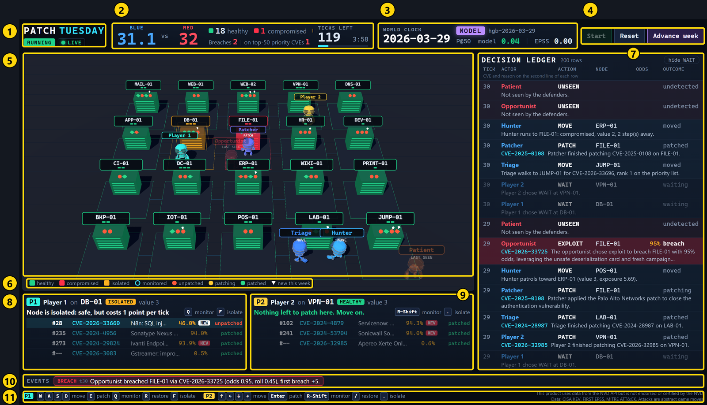
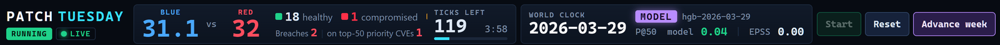
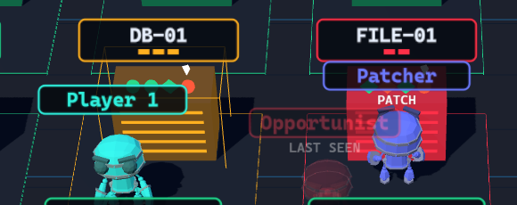
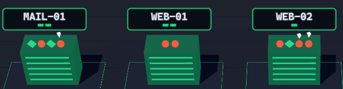
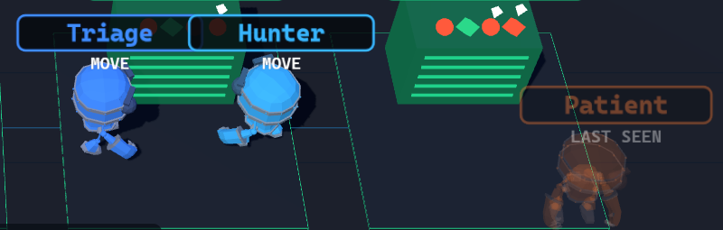
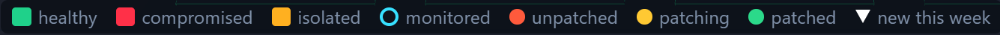
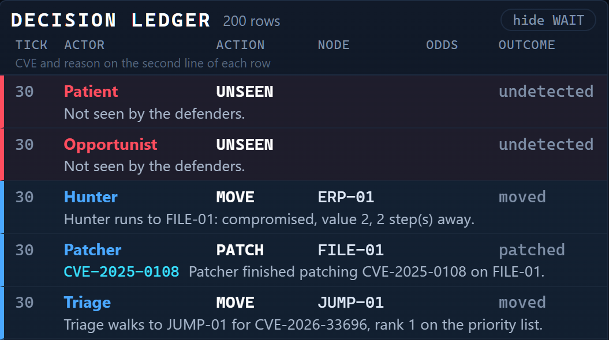
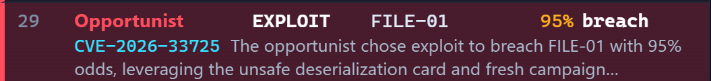
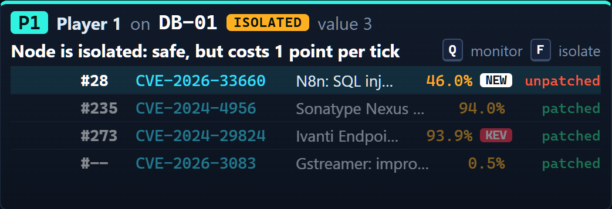
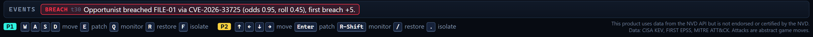

# Patch Tuesday: screen guide

This page explains every part of the game screen: what each panel, colour, shape and label means,
where to look for a piece of information, and when it changes. For how to install and start the
game, see the main [README](../README.md).

**The goal, in one line.** You and a second player defend a 20-machine network for 150 ticks
(5 minutes). Patch the dangerous vulnerability cards before the hidden red attackers use them, and
restore any machine they take over. When the clock runs out, the higher score wins; equal scores
are a DRAW.

*A real match, captured at tick 30 right after **Advance week** moved the world to 2026-03-29. Player 1
has isolated DB-01 (amber), the Opportunist has just breached FILE-01 (red) and both red attackers
are hidden ("LAST SEEN").*

| # | Area | What it tells you | Changes |
|---|---|---|---|
| 1 | [Title, match phase, connection](#1-title-match-phase-and-connection) | Is a match running, is the page connected | On start/end; on connect/disconnect |
| 2 | [Scoreboard](#2-scoreboard) | Who is winning, how many machines are down, time left | Every tick |
| 3 | [World clock](#3-world-clock) | Which real-world week the board shows and where the odds come from | When a week is advanced |
| 4 | [Buttons](#4-buttons) | Start, Reset, Advance week | You click them |
| 5 | [The board](#5-the-board) | The network, every card's status, every character | Every tick |
| 6 | [Board legend](#6-board-legend) | Key to the colours and marks on the board | Never |
| 7 | [Decision ledger](#7-decision-ledger) | Every move every actor made, with the reason | Every tick |
| 8, 9 | [Player panels](#8-and-9-player-panels) | Your machine, what to press next, its cards in patch order | Every tick and on each key press |
| 10 | [Events ticker](#10-events-ticker) | Breaches, restores, new weeks, campaigns | When something notable happens |
| 11 | [Key reminder and notices](#11-key-reminder-and-data-notices) | Both players' keys; data credits | Never |

Pop-ups that appear over these areas are explained in [Pop-ups and overlays](#pop-ups-and-overlays).

## Icon cheat sheet

| You see | Where | Meaning |
|---|---|---|
| Green machine, green label border | Board | Healthy |
| Red machine that pulses, red label border | Board | **Compromised**: an attacker has taken it. Red scores its value every tick until someone restores it |
| Amber machine inside an amber wire box | Board | **Isolated**: cut off for 5 ticks. Cannot be breached, attackers on it are thrown out, Red earns nothing from it, Blue loses 1 point per tick. **It is a pause, not a fix:** a breached machine is still breached underneath and turns red again after 5 ticks unless someone restores it |
| Cyan ring on the floor and a small spinning ring above the machine | Board | **Monitored** (3 ticks). Halves breach odds and reveals any attacker standing there |
| Red shock ring spreading out of a machine | Board | The machine just turned compromised: usually a breach, but also when a breached machine comes out of isolation |
| Short bars under a machine's name (1 to 3) | Board | Machine **value**: points at stake on it |
| Round dot on top of a machine | Board | One vulnerability card |
| Diamond on top of a machine | Board | A card whose CVE is on the CISA **KEV** list (known to be exploited). *Not in the legend* |
| Dot or diamond colour: red / blinking yellow / green | Board | Card unpatched / being patched / patched |
| Small white spinning arrow above a card | Board | Card **new this week**: it arrived with the last **Advance week** |
| Robot with a name tag | Board | A character. Second line of the tag = what it is doing now (blank while waiting) |
| Faint see-through robot tagged **LAST SEEN** | Board | A hidden attacker, drawn where the defenders last saw it. It may have moved since |
| Pulsing coloured ring under a robot | Board | That robot is a human player (cyan = Player 1, yellow = Player 2) |
| `KEV` red tag | Player panel | Same as the diamond: known exploited |
| `NEW` white tag | Player panel | Same as the white arrow: new this week |
| `#28` | Player panel | Patch-priority rank: the 28th most urgent CVE in the whole world this week. `#--` = outside the top 500 |
| `46.0%` (amber) | Player panel | The card's score: the predicted chance it gets exploited. It drives breach odds |
| `95%` (amber) | Ledger, ODDS column | The actual breach odds of that one exploit attempt |
| Red left stripe / blue left stripe | Ledger | Row by a red attacker / by a defender |
| Dark red row | Ledger | A breach |
| Faded row | Ledger | A WAIT (hide them with the **hide WAIT** chip) |
| `MODEL` purple badge / `EPSS` amber badge | World clock | Card scores come from this week's trained model / from FIRST EPSS |

## 1. Title, match phase and connection

Under the **PATCH TUESDAY** title are two small badges.

- **Match phase:** `LOBBY` (grey, waiting for Start), `RUNNING` (green) or `ENDED` (amber).
- **Connection to the game server:**
  - `LIVE` with a green dot: connected; the screen updates every tick.
  - `CONNECTING` or `RECONNECTING (n)` with a blinking red dot: trying to reach the server.
  - `OFFLINE, RETRYING`: the server went away; the page keeps retrying by itself.
  - `MOCK DATA` (purple): the page was opened with `?mock=1` and shows a built-in demo, not real data.

## 2. Scoreboard

Same image as above, middle section.

| Item | Meaning |
|---|---|
| **BLUE** (big blue number) | The defenders' score: yours, your partner's and the three blue agents' together. Patching a card before anyone has tried to exploit it earns *machine value × card score*, so this often has decimals. Each restore earns +3. Each isolated machine costs 1 per tick |
| **RED** (big red number) | The attackers' score: +5 for the first breach of each machine, plus each compromised machine's value every tick. An isolated machine earns Red nothing while the isolation lasts |
| **healthy / compromised / isolated** | How many of the 20 machines are in each state right now. A breached machine that is isolated counts as isolated |
| **Breaches** | Successful break-ins so far this match |
| **on top-50 priority CVEs** | How many of those breaches came through a card ranked #1 to #50, a CVE the pipeline said to patch first. A high number means the defence ignored the priority list |
| **TICKS LEFT** and `m:ss` | Ticks remaining out of 150, and the same as clock time (2 s per tick unless the server was started with `-TickSeconds`) |
| Thin bar under the ticks | Match progress |

## 3. World clock

| Item | Meaning |
|---|---|
| **WORLD CLOCK** date | The simulated "today". The board only knows CVEs, KEV entries and EPSS scores published up to this date. Day 0 is 2026-03-22; each **Advance week** adds 7 days, up to 2026-06-14. The date flashes when it changes |
| `MODEL` or `EPSS` badge | Where every card's score comes from this week. `MODEL` (purple) means the pipeline's own model passed the promotion gate: it beat EPSS on the held-out quarter, with at least 10 real KEV entries to judge by. `EPSS` (amber) means it did not pass (it lost, tied, or there was too little data), so FIRST's EPSS scores are used |
| Text next to the badge | The model version in use (for example `hgb-2026-03-29`), or `no model promoted` |
| `advancing` with a spinner | The pipeline is building the next week in the background. The match keeps running |
| **P@50 model / EPSS** | The promotion test: of each scorer's top 50 picks on the held-out quarter, the share that really entered KEV. The higher of the two is shown in green (EPSS wins ties). The model's number can be the green one under an `EPSS` badge when the gate failed for lack of data. These are small numbers by nature; see the README's gate table |

## 4. Buttons

| Button | What it does |
|---|---|
| **Start** | Starts a 150-tick match. Greyed out while a match is running |
| **Reset** | Ends the current match and returns to the lobby. It does not advance the world, but the lobby shows the latest finished week, so a week advanced late in the match appears now. It does not stop an advance that is still running |
| **Advance week** | Moves the world forward one real week of vulnerability data (about 20-30 s). While it runs it reads **Advancing...** and is greyed out. If it finishes before tick 125 of a running match, the new week's cards drop onto the board and the attackers start a campaign on those that landed on healthy machines. If it finishes in the last 25 ticks, nothing drops and the clock keeps the old date until the next match. After 2026-06-14 there are no more weeks |

## 5. The board

The network is a 5 × 4 grid of 20 machines joined by thin blue lines. Characters move one step
at a time along those lines (north, south, east or west). Up on the screen is north: **W** or **↑**
moves up. The exception is an attacker standing on a machine it has taken: it can pivot up to two
steps away, diagonals included, in one tick, so it may slide straight across the board.

### Machines

*Left: DB-01 isolated (amber, wire cage) with Player 1 standing on it. Right: FILE-01 compromised
(red) while the Patcher works on it; the faint red robot is the Opportunist, hidden, at its last seen
spot.*

- **Label above the machine:** the name and 1 to 3 short bars for its value. The label border and the
  glowing strips on the machine share the machine's state colour: green healthy, red compromised,
  amber isolated.
- **Compromised machines pulse red.** At the moment of a breach a red shock ring spreads out of the
  machine.
- **Isolated machines** sit inside an amber wire box for 5 ticks, then return to their previous state.
  A breached machine that is isolated is still breached underneath: it turns red again (with the
  shock ring) when the isolation ends, unless someone restores it during the 5 ticks.
- **Monitored machines** get a cyan ring on the floor and a small spinning cyan ring above the
  machine for 3 ticks (6 ticks after a restore). A character standing on the pad can hide the floor
  ring.

### Cards on a machine

*MAIL-01 has two patched KEV cards (green diamonds) and two unpatched cards (red dots); the right
one is new this week (white arrow). WEB-01 has two unpatched cards.*

Each mark on top of a machine is one vulnerability card, that is, one real CVE.

- **Shape:** a dot is an ordinary CVE. A **diamond** is a CVE on the CISA KEV list, which is known
  to be exploited and adds +0.15 to breach odds.
- **Colour:** red = unpatched. Blinking yellow = patch in progress. Green = patched (it can no
  longer be used).
- **White spinning arrow above a mark:** the card is new this week.

The board shows only the state. To see which CVE a mark is, its score and its rank, stand on the
machine and read your [player panel](#8-and-9-player-panels).

### Characters

*Triage and Hunter (blue agents) moving; the faint Patient is a hidden attacker at its last seen
spot.*

| Robot colour | Who | Team |
|---|---|---|
| Red | Opportunist | Red agent |
| Orange | Patient | Red agent |
| Blue | Triage | Blue agent |
| Violet | Patcher | Blue agent |
| Light blue | Hunter | Blue agent |
| Cyan, with a cyan ring underneath | Player 1 (you) | Blue human |
| Yellow, with a yellow ring underneath | Player 2 | Blue human |

- **Name tag:** the first line is the name in the character's colour. The second line is the action
  it is doing now, such as `MOVE`, `PATCH`, `EXPLOIT`, `SCAN`, `MONITOR`, `ISOLATE` or `RESTORE`.
  It is blank while the character waits.
- **Hidden attackers:** you see a red attacker only right after it breaches, when a failed attack on
  a monitored machine gets it detected, or while it stands on a monitored machine. Otherwise it is
  drawn faint, tagged **LAST SEEN**, at the spot where it was last seen. It may be somewhere else by
  now. The blue agents know no more than you: they see an attacker only while it is revealed.
- **Gestures:**
  - a punch is an exploit attempt
  - a nod is a scan (or the Hunter's INTEL search, if enabled)
  - a wave is starting to monitor
  - a head shake is isolating
  - a jump is starting a restore
  - a thumbs-up is a finished patch or restore
- **At the end of the match** the winning team dances and the losing team falls over (on a draw the
  defenders dance).
- Several characters can share one machine; each has its own spot on the pad.

## 6. Board legend

The legend is a fixed key to the board's colours: machine states, the monitored ring, the three card
colours and the new-this-week arrow. It does not list the diamond shape for KEV cards; see
[Cards on a machine](#cards-on-a-machine).

## 7. Decision ledger

Every character's decision, every tick, newest at the top. It keeps the latest 200 rows and its
header shows the count. Each row has two lines.

**First line:**

| Column | Meaning |
|---|---|
| TICK | The tick of the decision |
| ACTOR | Who decided, in red (attacker) or blue (defender). The stripe on the row's left edge shows the same |
| ACTION | What they did. For a hidden attacker this is `UNSEEN`, and the row then shows no machine, odds or CVE, the outcome `undetected` and the reason "Not seen by the defenders." An attacker's rows show in full while it stands on a monitored machine, for 2 ticks after a breach, and after it is detected |
| NODE | The machine the actor is on after the action (the destination, for a move) |
| ODDS | Breach odds, only on exploit attempts |
| OUTCOME | What happened (list below) |

**Second line:** the CVE involved (when there is one), then a one-sentence reason. The game writes
this reason straight away. When an LLM key is set, the reasons for the agents' exploits, patches, isolations,
restores and campaign moves are rewritten a moment later by the language model, and the new text flashes briefly as it appears.
Player rows and "continues..." rows keep the game's own wording. (*reason pending...* appears only
in the `?mock=1` demo.)

*A breach row: dark red background, odds 95%, outcome `breach`, and the attacker's reason.*

**Row styles:** WAIT rows are faded, and the **hide WAIT** chip in the header hides them. Breach
rows have a dark red background.

**Outcome words:**

| Outcome | Means |
|---|---|
| `moved` / `blocked` | Moved to the next machine / could not (edge of the grid, or an attacker scanning an isolated machine) |
| `patching` → `patched` | Patch started / finished (2 ticks) |
| `restoring` → `restored` | Restore started / finished (3 ticks) |
| `monitoring` / `isolated` | Monitoring or isolation started |
| `working` | Still busy with a multi-tick action |
| `scanned` / `pivoted` | Attacker scouted a machine (raises its odds there) / jumped from a taken machine |
| `breach` / `failed` | Exploit succeeded / failed |
| `undetected` | A hidden attacker did *something*; the defenders do not know what |
| `waiting`, `infiltrating`, `digging in`, `regrouping`, `ejected` | Idle, or a forced pause: attackers start the match infiltrating, rest after a breach or a failed attempt, and are thrown out by an isolation |
| `invalid` / `noop` | The action did not apply (for example, patching a machine with nothing left to patch) |
| `requested` | The Hunter asked Telem for public reports (only with `-Telem`) |

Hidden attackers' rows stay `UNSEEN` on the page for the whole match. Once the match has ended,
reloading the page shows the last 200 rows (about the last 28 ticks) unhidden. Earlier hidden moves
are kept only in the server's ledger files (`ledger/ledger.jsonl`, `data/game.duckdb`).

## 8 and 9. Player panels

Player 1's panel is on the left (cyan) and Player 2's on the right (yellow). Each panel always shows
the machine that player is standing on.

**Header line:**

- The player tag (`P1` / `P2`), "on", and the machine name.
- A state tag: `HEALTHY`, `COMPROMISED` (blinking red) or `ISOLATED`.
- `value` and the machine's value.
- `MONITORED`, when the machine is being monitored.
- On the right, one of:
  - `PATCH 1t` (amber): while you are busy, your running action and the ticks it still needs. A key
    pressed now is kept and applied on your first free tick.
  - `sent MOVE N` (green): your key press reached the server.
  - `queued PATCH` (amber): you already acted this tick; the key is applied next tick.
  - `match not running` or `not connected` (grey).

  Key feedback shows for about 4 seconds after a press.

**Advice line:** what to press here. Only the first that applies is shown:

1. Machine compromised: `R` / `/` **RESTORE this node (3 ticks)**, in red.
2. Machine isolated: *Node is isolated: safe, but costs 1 point per tick*. Isolation is only a
   pause. If the machine was breached, press RESTORE before the 5 ticks run out, or it turns red
   again. RESTORE and PATCH both work here even though the panel shows no key for them.
3. Something left to patch: `E` / `Enter` **PATCH the top card (2 ticks)**.
4. Otherwise: *Nothing left to patch here. Move on.*, in green.

The monitor and isolate keys are always listed on the right of that line.

**Card list:** the cards on the machine, most urgent first. This is the order the server patches
in. It shows up to 4 rows (5 on screens at least 900 px tall), so on a short screen a machine's
fifth, least urgent card can be cut off.

| Column | Meaning |
|---|---|
| key | The patch key (`E` or `Enter`) appears on the card your next patch will take, and that row is tinted cyan. On an isolated machine only the tint shows, but the key still works |
| `#28` | Patch-priority rank among every CVE known this week. `#--` = not in the top 500 |
| `CVE-...` | The CVE id |
| Title | Vendor or product and weakness class, such as `Ivanti Endpoi...` or `N8n: SQL inj...` |
| `46.0%` | The card's score: predicted chance of exploitation, from the source shown on the world clock |
| `KEV` / `NEW` | Known exploited / arrived this week |
| State | `unpatched` (red), `patching` (yellow), `patched` (green, row dimmed) |

**Why patch the top card first:** patching earns *machine value × card score*, but only if no
attacker has tried that card yet. High-score cards on high-value machines are worth the most and
are also what the attackers go for.

## 10. Events ticker

A strip of notable events, newest on the left. It keeps the latest 40 and is cleared when a new
match starts or the game is reset. Each event shows its kind, the tick (`t30`) and a sentence.

| Kind | Colour | Example |
|---|---|---|
| `BREACH` | Red | Opportunist breached FILE-01 via CVE-... (odds 0.95, roll 0.45), first breach +5 |
| `CAMPAIGN` | Strong red | The attackers' plan for the freshest high-score cards after a new week |
| `DROP` | Cyan | 12 new cards dropped on 11 nodes |
| `GATE` | Purple | Whether this week's model was promoted, with both P@50 numbers |
| `RESTORED` | Plain | Hunter restored POS-01 (+3) |
| `INTEL` | Plain | Hunter's Telem result (only with `-Telem`) |
| `INFO` | Plain | Match start, isolations, detections, advance progress and world changes, the final result, and the end-of-match **reveal**: how many board cards really entered KEV within 91 days, and how many Blue patched in time |

Finished patches are not listed here. They are in the ledger and add to the Blue score.

## 11. Key reminder and data notices

The bottom line repeats both players' keys:

| | Move | Patch | Monitor | Restore | Isolate |
|---|---|---|---|---|---|
| Player 1 | W A S D | E | Q | R | F |
| Player 2 | Arrow keys | Enter | Right Shift | / | . |

- **One action per tick:** each player gets one action per tick. A second press in the same tick
  waits for the next tick (see the panel header). Only your latest press is kept, so a newer press
  replaces the waiting one. Holding a move key keeps walking, one step per tick.
- **Multi-tick actions:** patch and restore keep you busy for 2 and 3 ticks.
- **Instant actions:** monitor and isolate take effect at once and last 3 and 5 ticks.

On the right are the NVD notice and the data credits.

## Pop-ups and overlays

| What | Where | When |
|---|---|---|
| **READY** "Press Start to begin a 5 minute match" | Over the board | In the lobby |
| **CONNECTING** / **WAITING FOR GAME SERVER** | Over the board | Before the first update from the server |
| **BLUE HOLDS THE NETWORK**, **RED WINS** or **DRAW**, with the final scores and breach counts | Over the board | When the match ends |
| Cyan banner (new cards) or purple banner (gate result) | Top of the board, 5 s | When an advanced week lands |
| Full-screen **RED CAMPAIGN** with the attackers' targets | Whole screen, about 3 s | Right after new cards drop |
| Small note, such as "Character model did not load. Using simple capsule figures." | Corner of the board | If the 3D model or WebGL is unavailable (the rest still works) |

## Where do I find...

| Question | Look at |
|---|---|
| Am I winning? | Scoreboard: BLUE vs RED (2) |
| How long is left? | Scoreboard: TICKS LEFT and `m:ss` (2) |
| What should I press now? | The advice line in your panel (8 or 9) |
| Which card will my patch take? | The row with your patch key in your panel (8 or 9) |
| How dangerous is a card? | Its `%` score and `#` rank in your panel; a diamond or `KEV` tag |
| Which machines are under attack? | Red, pulsing machines on the board (5); `BREACH` events (10) |
| Where are the attackers? | Solid red/orange robots on the board; faint ones are only where they were last seen (5) |
| Why did an agent do that? | Its row in the decision ledger (7) |
| What changed in the new week? | White arrows on the board, `NEW` tags, and the `DROP` and `CAMPAIGN` events (5, 8, 10) |
| Is the model or EPSS setting the odds? | The badge on the world clock (3) |

## Page options

Add these to the address (for example `http://localhost:5173/?mock=1`):

| Option | Effect |
|---|---|
| `?mock=1` | Demo mode with built-in fake data (CVE-2099-... ids), no server needed |
| `?yaw=35` | Turns the camera for a spectator's isometric view (movement keys then no longer match "up") |
| `?pitch=60` | Camera tilt, 25 to 80 degrees (default 46) |
| `?nomodel=1` | Simple capsule figures instead of robots |
